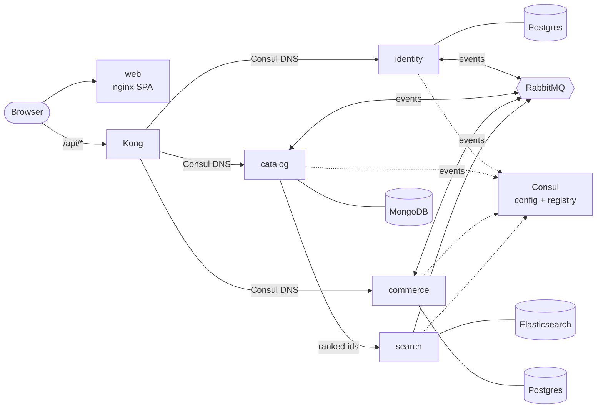

# SEAPEDIA

> **Software Engineering Academy — COMPFEST 18**  

SEAPEDIA is a multi-role e-commerce platform connecting Buyers, Sellers, Drivers, and Admins in a single marketplace. Built progressively across 7 levels, it supports product catalog browsing, authentication with role awareness, store and product management, wallet and checkout, discounts, delivery workflows, admin monitoring, and security hardening.

## Documentation

Comprehensive documentation is available in the [`docs/`](./docs/) folder:

| Document | Description |
|----------|-------------|
| [Documentation Index](./docs/README.md) | Full documentation overview |
| [Setup Guide](./docs/SETUP.md) | Installation & deployment |
| [Authentication](./docs/AUTH.md) | Multi-role auth system |
| [Business Rules](./docs/BUSINESS-RULES.md) | Core rules & calculations |
| [Order Lifecycle](./docs/ORDER-LIFECYCLE.md) | Order status flow |
| [Demo Guide](./docs/DEMO-GUIDE.md) | Step-by-step walkthrough for judges |
| [API Reference](./docs/API.md) | Endpoint overview |
| [Database Schema](./docs/SCHEMA.md) | Schema reference |
| [Security](./docs/SECURITY.md) | Security measures |

Role-specific flows: [Guest](./docs/GUEST.md) | [Seller](./docs/SELLER.md) | [Buyer](./docs/BUYER.md) | [Driver](./docs/DRIVER.md) | [Admin](./docs/ADMIN.md)

Feature deep dives: [Discounts](./docs/DISCOUNTS.md) | [Delivery](./docs/DELIVERY.md) | [Overdue Handling](./docs/OVERDUE.md) | [Seed Data](./docs/SEED-DATA.md)

## Architecture

Seapedia runs as microservices behind **Kong**. Each domain service owns its data in a database
chosen for its workload, and services integrate by **choreography**: they publish and react to
events on **RabbitMQ** instead of calling each other. **Consul** holds configuration and the service
registry.



| Service | Type | Owns | Data store |
|---------|------|------|------------|
| Kong ([infra/kong](./infra/kong)) | API gateway | routing, JWT check, CORS, rate limits | none |
| [identity](./services/identity) | domain | users, roles, sessions, tokens | Postgres |
| [catalog](./services/catalog) | domain | stores, products, reviews | MongoDB |
| [commerce](./services/commerce) | domain | cart, wallet, checkout, orders, discounts, delivery, admin, stock | Postgres |
| [search](./services/search) | read model (CQRS) | product search index | Elasticsearch |
| [web](./apps/web) | frontend | React SPA | none |

Patterns: database per service (polyglot persistence), choreography with a transactional outbox
and inbox, event-carried state transfer, CQRS read model, API gateway, client-credentials service
tokens, centralized configuration, and hybrid service discovery. Each service has its own
Dockerfile, image (`ghcr.io/sayyidrafeed/seapedia-<service>`), CI job, and Dokploy deployment.

Read more: [overview](./docs/architecture/overview.md) · [data ownership](./docs/architecture/data-ownership.md) ·
[communication](./docs/architecture/communication.md) · [security](./docs/architecture/security.md) ·
[platform](./docs/architecture/platform.md) · [decisions](./docs/architecture/decisions/)

## Tech Stack

| Layer | Choice |
|-------|--------|
| Runtime | [Bun](https://bun.sh) workspace monorepo |
| Services | [Hono](https://hono.dev), [Zod](https://zod.dev), OpenAPI via `hono-openapi` |
| Data | PostgreSQL 17 ([Drizzle ORM](https://orm.drizzle.team)), MongoDB 7.0, Elasticsearch 9 |
| Integration | [RabbitMQ](https://www.rabbitmq.com) 4 (topic exchange, retry and parking queues) |
| Edge | [Kong](https://konghq.com) 3.9 OSS, DB-less |
| Platform | [Consul](https://www.consul.io) (KV configuration, registry, DNS) |
| Auth | RS256 access tokens (10 min) + rotating refresh tokens, per-device sessions, client credentials |
| Web | [React 19](https://react.dev), [Vite](https://vite.dev), [TanStack Router](https://tanstack.com/router) and [Query](https://tanstack.com/query), [Tailwind CSS v4](https://tailwindcss.com), [hey-api](https://heyapi.dev) SDK |
| Object storage | [Cloudflare R2](https://www.cloudflare.com/en-gb/developer-platform/products/r2/) presigned uploads |
| Delivery | Docker images built by CI on GitHub runners and pushed to GHCR; deployed on [Dokploy](https://dokploy.com) from `docker-compose.deploy.yml` |
| Security checks | CI fails on high/critical dependency advisories (`bun audit`); images pinned to exact patched versions ([assessment](./docs/architecture/security.md#vulnerability-management)) |

## Quick Start

Requires Bun 1.4.4 and Docker. Everything from production images:

```bash
bun install
bun scripts/generate-secrets.ts > .env.prod.local
docker compose -f docker-compose.prod.yml --env-file .env.prod.local up -d --build
docker compose -f docker-compose.prod.yml --env-file .env.prod.local --profile tools run --rm seed
bun run smoke
```

Development with hot reload (infrastructure and Kong in Docker, services on the host):

```bash
bun install
bun scripts/generate-secrets.ts --dev
docker compose up -d
bun run dev
```

See [docs/SETUP.md](./docs/SETUP.md) for details.

### Useful URLs

| What | Production | Local |
|------|------------|-------|
| Web app | [seapedia.sayyidrafee.com](https://seapedia.sayyidrafee.com) | http://localhost:5173 (dev), http://localhost:8080 (prod-like) |
| API (Kong) | [api-seapedia.sayyidrafee.com](https://api-seapedia.sayyidrafee.com) | http://localhost:3001 |
| API docs (Scalar) | [seapedia.sayyidrafee.com/docs](https://seapedia.sayyidrafee.com/docs) | `/docs` on the web app |
| Consul UI, RabbitMQ UI | not public | http://localhost:8500, http://localhost:15672 |

## Project Structure

```
seapedia/
├── apps/web/              # React SPA (talks only to Kong)
├── services/
│   ├── identity/          # users, roles, sessions, tokens   → Postgres
│   ├── catalog/           # stores, products, reviews        → MongoDB
│   ├── commerce/          # cart, wallet, orders, stock      → Postgres
│   └── search/            # read model                       → Elasticsearch
├── packages/platform/     # technical code shared by services (auth, events, Consul)
├── infra/
│   ├── kong/              # API gateway image and declarative config
│   ├── consul/            # configuration defaults
│   ├── rabbitmq/          # per-service broker users and permissions
│   ├── mongo/             # replica set bootstrap
│   └── seed/              # ops tool: seeds the three databases
├── scripts/               # smoke test, OpenAPI merge, secret generation
├── docker-compose.yml     # dev infrastructure + Kong
├── docker-compose.prod.yml
└── docs/                  # architecture, setup, deployment, business flows
```

## Features by Level

| Level | Feature | Points |
|-------|---------|--------|
| 1 | Public marketplace, auth & role awareness, public reviews, reusable UI | 20 |
| 2 | Seller store & product management, public catalog | 15 |
| 3 | Buyer wallet, cart, checkout, order history | 20 |
| 4 | Voucher/promo discounts, seller order processing, reports | 15 |
| 5 | Delivery workflow, driver dashboard & earnings | 10 |
| 6 | Admin monitoring, discount management, overdue handling | 10 |
| 7 | Security hardening (XSS, SQLi, RBAC, input validation) | 10 |
| **Bonus** | UI quality + deployment | 25 |

## Business Rules

### Single-Store Checkout Rule

SEAPEDIA is a multi-seller marketplace, but each cart may only contain products from **one store**. If a buyer tries to add a product from a different store, the system prevents the addition and displays an explanatory confirmation dialog. The buyer can choose to cancel the action or clear the cart and switch to the new store. This rule is enforced on both the frontend (UI guard) and backend (API validation).

### Transaction and Financial Reports

- **Seller Revenue:** Calculated exclusively as the sum of `subtotal` from fully completed (`pesanan_selesai`) orders. Delivery fees, PPN, and other checkout components are excluded from seller income to keep marketplace accounting consistent.
- **Buyer Spending:** Calculated as the sum of `totalAmount` strictly from fully completed (`pesanan_selesai`) orders. This excludes cancelled, refunded, or returned orders, aligning with the refund/return mechanics.

### Discount System

| Type | Description | Expiry | Usage Limit |
|------|-------------|--------|-------------|
| **Voucher** | Buyer-facing discount code generated by Admin | Yes | Yes (limited uses) |
| **Promo** | Platform-wide discount event managed by Admin | Yes | No usage limit |

- **Combination rule:** Voucher and Promo **cannot be combined** in a single checkout. If both are provided, the system applies the discount with the higher value.
- **Calculation order:** Subtotal → Discount → Delivery fee → PPN 12% → Final total.
- PPN 12% is applied to (subtotal − discount + delivery fee).

### Driver Earning Rule

Drivers earn **100% of the delivery fee** for each completed delivery. The delivery fee is set during checkout based on the selected delivery method and fully passed to the driver upon successful job completion. The earning amount is displayed in the job detail view before the driver accepts the job.

### Delivery SLA and Overdue Handling

| Method | SLA | Overdue Action |
|--------|-----|----------------|
| Instant | 1 simulation day | Auto refund to Buyer wallet |
| Next Day | 2 simulation days | Auto refund to Buyer wallet |
| Regular | 3 simulation days | Auto return (refund + stock restore) |

When an order becomes overdue:
- Buyer wallet is credited with the refund amount.
- Seller income is reversed (or excluded if not yet recorded).
- Product stock is restored.
- Order status moves to **Dikembalikan**.
- Status change is recorded with a timestamp in the order history.

The system prevents double refund, double reversal, or double stock restoration for the same order.

### Time Simulation

The Admin dashboard provides a trigger to advance simulated time by 1 day. Overdue orders are identified and processed automatically after each advance. The trigger is idempotent.

## Demo Accounts

The seed (`bun run seed`, or the `seed` compose profile) creates 19 users from
[`infra/seed/src/seed/data/users.data.ts`](./infra/seed/src/seed/data/users.data.ts). Every
seeded account uses the password `password123`. A few to start with:

| Username | Roles |
|----------|-------|
| `admin` | Admin |
| `budi_santoso` | Seller |
| `dewi_lestari` | Buyer |
| `joko_widodo` | Driver |
| `rina_multi` | Seller, Buyer, Driver |

## API Documentation

Interactive API documentation (Scalar) is served by the web app at `/docs`, from
`apps/web/public/openapi.json`: the merged contract of identity, catalog and commerce, built by
`bun scripts/openapi.ts`. The file is generated, not committed: run that script with the services
up whenever a public API changes. The web SDK is generated from the same file
(`cd apps/web && bun run openapi:generate`).

## Security Measures

### SQL Injection Prevention

All database access uses **Drizzle ORM** with parameterized queries. Raw SQL is not used. Drizzle's type-safe query builder escapes user input automatically.

### XSS Prevention

User-generated content (application reviews, comments) is sanitized before rendering. React's built-in JSX escaping provides baseline protection. HTML tags in public comments are rendered as plain text.

### Input Validation

Every HTTP boundary (path params, query params, request body) is validated using **Zod schemas**. Required fields (email, phone, rating, quantity, price, stock, discount values) are enforced server-side. Invalid input is rejected with structured 400 Bad Request responses.

### Session & Token Behavior

The identity service issues an RS256 access token in the HttpOnly `__access` cookie and a rotating refresh token in the HttpOnly `__refresh` cookie, scoped to `/api/auth`. Each login is a per-device session. `POST /api/auth/refresh` rotates the refresh token. `POST /api/auth/logout` revokes the session and clears both cookies. Token lifetimes come from Consul configuration.

### Role-Based Access Control

Authorization is enforced **server-side** on every protected endpoint. The backend verifies the **active role** before granting access. Admin-only endpoints are inaccessible to non-admin users. Resource ownership is enforced: Sellers manage only their own products, Buyers view only their own orders, Drivers can only take available jobs.

## Testing Guide

This guide describes how to verify the multi-role flows and security features of SEAPEDIA.

### 1. Setup
Start the development stack (see [Quick Start](#quick-start)) and seed the databases:
```bash
docker compose up -d
bun run dev
bun run seed   # wipes the three databases and rebuilds the search index
```

All seeded accounts use the password `password123` (see [Demo Accounts](#demo-accounts)).

### 2. Admin Walkthrough
1. Go to [http://localhost:5173/auth/login](http://localhost:5173/auth/login) (or click Login).
2. Login with `admin` / `password123`.
3. Verify access to the Admin Dashboard (discounts management, system time simulation).
4. Go to simulated time controls, advance simulated time by 1 day, and check that overdue orders are processed if any.

### 3. Seller Walkthrough
1. Login with `budi_santoso` / `password123`.
2. Verify you can view the Seller Dashboard.
3. Add a new product or edit an existing one.
4. Verify you can see incoming orders in the orders section.

### 4. Buyer Walkthrough
1. Login with `dewi_lestari` / `password123`.
2. Go to the Catalog, add a product to the cart.
3. Top up the wallet if the balance is low (go to Wallet tab, select/input amount, and click "Top Up" to add balance immediately).
4. Complete the checkout using single-store checkout.
5. Check Order History and verify the status is "Menunggu Konfirmasi" (Pending Confirmation).

### 5. Driver Walkthrough
1. Login with `joko_widodo` / `password123`.
2. Accept a delivery job from the Driver Dashboard.
3. Complete the delivery stages.
4. Verify driver earnings increase by 100% of the delivery fee.

### 6. Multirole Walkthrough
1. Login with `rina_multi` / `password123`.
2. Use the role switcher in the navigation bar to switch between Seller, Buyer, and Driver dashboards.
3. Verify role-specific navigation guards restrict access depending on the active role.

## Security Test Checklist

To verify the security controls implemented in Level 7:

- [ ] **SQL Injection Prevention:**
  Verify that all queries are parameterized. Input single quotes `'` or SQL keywords like `OR 1=1` into Search fields, Review Comments, or Login fields. Ensure they are treated as literal strings and do not cause SQL syntax errors or bypass checks.
- [ ] **Cross-Site Scripting (XSS) Prevention:**
  Log in as a Buyer and leave a review comment containing `<script>alert('XSS')</script>`. Verify that the script tag renders as plain text in the public catalog reviews list and no alert popup is triggered.
- [ ] **Input Validation:**
  Attempt to submit invalid fields (e.g. invalid email format in registration, negative price in product management, rating out of bounds `[1-5]`). Verify that the server rejects these with a `400 Bad Request` and structured Zod validation errors.
- [ ] **Session Invalidation on Logout:**
  Log in and copy the `__refresh` cookie from browser devtools. Click Logout. Replay `POST /api/auth/refresh` with the copied cookie via curl/Postman. Verify it is rejected with `401 Unauthorized` because logout revoked the session.
- [ ] **Role-Based Access Control (RBAC):**
  Attempt to access a protected endpoint directly (e.g., GET `/api/admin/dashboard` or POST `/api/seller/products`) without logging in or using a buyer session. Verify the API returns `401 Unauthorized` or `403 Forbidden` rather than exposing the endpoint.
- [ ] **Resource Ownership Enforcement:**
  Attempt to retrieve or modify another buyer's order or another seller's store products using direct API calls (e.g. GET `/api/orders/{orderId}`). Verify that the service scopes queries by the current user ID and denies access.

## Deployment

Each service, Kong, and the web app is a separate Dokploy application pulled from GHCR and
redeployed by its own webhook when CI publishes a new image. See [docs/DEPLOYMENT.md](./docs/DEPLOYMENT.md).

| Service | URL |
|---------|-----|
| Web app | [https://seapedia.sayyidrafee.com](https://seapedia.sayyidrafee.com) |
| API docs | [https://api-seapedia.sayyidrafee.com/docs](https://api-seapedia.sayyidrafee.com/docs) |

---

### Sub-Project READMEs

- [Web app](./apps/web/README.md)
- [identity](./services/identity/README.md),
  [catalog](./services/catalog/README.md), [commerce](./services/commerce/README.md),
  [search](./services/search/README.md)
