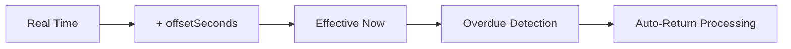

# Admin Flow

Admins are platform administrators who monitor the marketplace, manage discounts, and handle operational tasks like overdue order processing.

## Admin Dashboard

After logging in as Admin, the admin accesses the Admin Dashboard with these sections:

| Section | Description |
|---------|-------------|
| Overview | Marketplace statistics summary |
| Users | User monitoring |
| Stores | Store monitoring |
| Products | Product monitoring |
| Orders | Order monitoring |
| Discounts | Voucher and Promo management |
| Deliveries | Delivery job monitoring |
| Overdue | Overdue order monitoring |
| Time Simulation | Advance simulated time |

## Monitoring Dashboard

### Overview Stats

The dashboard shows aggregate counts:

| Metric | Description |
|--------|-------------|
| Total Users | Count by role (admin, buyer, seller, driver) |
| Total Stores | All registered stores |
| Total Products | All listed products |
| Total Orders | Count by status |
| Total Discounts | Voucher and promo counts |
| Total Deliveries | Count by status (pending, taken, completed) |
| Overdue Orders | Orders exceeding delivery SLA |

### Monitoring Pages

Each monitoring page shows a table of records with key fields:

- **Users**: username, email, roles, join date
- **Stores**: name, seller, product count, rating
- **Products**: name, store, price, stock, sold count
- **Orders**: buyer, store, status, total, date
- **Discounts**: code, type, value, expiry, usage
- **Deliveries**: order, driver, status, fee

## Discount Management

### Voucher Management

| Action | Description |
|--------|-------------|
| Create Voucher | Set code, amount, min order, expiry, usage limit |
| View Voucher List | See all vouchers with status |
| View Voucher Detail | See usage stats and expiry |

### Promo Management

| Action | Description |
|--------|-------------|
| Create Promo | Set code, percentage, max discount, min order, expiry |
| View Promo List | See all promos with status |
| View Promo Detail | See expiry and usage info |

### Discount Rules

- Voucher: flat amount discount (e.g., Rp 10,000 off)
- Promo: percentage discount with cap (e.g., 10% off, max Rp 50,000)
- Both have expiry dates
- Vouchers have limited usage; Promos have unlimited usage
- Voucher and Promo cannot be combined

## Time Simulation

### How It Works

SEAPEDIA uses a simulated time system for demo purposes. The system maintains a `systemTimeOffset` that shifts the effective "now" forward.

### Time Advance Button

1. Navigate to Time Simulation section
2. Click "Advance 1 Day" (24 hours)
3. System updates the time offset
4. Overdue orders are automatically processed
5. Results are displayed

### Constraints

- Maximum advance: 240 hours (10 days)
- Each advance is 24 hours (1 day)
- Offset can be reset to 0
- The trigger is idempotent

### SLA Thresholds

| Delivery Method | SLA | Overdue After |
|-----------------|-----|---------------|
| Instant | 2 hours | Order created > 2 hours ago |
| Next Day | 24 hours | Order created > 24 hours ago |
| Regular | 48 hours | Order created > 48 hours ago |

## Overdue Processing

### What Happens

When an order exceeds its delivery SLA:

1. Order status → `dikembalikan`
2. Buyer wallet is refunded (full `totalAmount`)
3. Product stock is restored
4. Status history entry is created
5. Refund transaction is recorded in wallet history

### Safety Measures

- Database transaction with `FOR UPDATE` lock
- Prevents double refund, double stock restoration
- Checks order is not already completed or returned
- Logs all changes in status history

### Code Reference

- `backend/src/modules/admin/admin.service.ts:207-327` — `processOverdueOrders()`

## API Endpoints

| Method | Endpoint | Description |
|--------|----------|-------------|
| GET | `/api/admin/summary` | Dashboard statistics |
| POST | `/api/admin/time/simulate` | Advance simulated time |
| POST | `/api/admin/overdue/process` | Process overdue orders |
| GET | `/api/admin/vouchers` | List all vouchers |
| POST | `/api/admin/vouchers` | Create voucher |
| GET | `/api/admin/vouchers/:id` | Voucher detail |
| GET | `/api/admin/promos` | List all promos |
| POST | `/api/admin/promos` | Create promo |
| GET | `/api/admin/promos/:id` | Promo detail |

## Code References

| Component | File |
|-----------|------|
| Admin service | `backend/src/modules/admin/admin.service.ts` |
| Admin routes | `backend/src/modules/admin/admin.routes.ts` |
| Admin constants | `backend/src/modules/admin/admin.constants.ts` |
| Admin schemas | `backend/src/modules/admin/admin.schemas.ts` |
| Discount service | `backend/src/modules/discounts/discounts.service.ts` |
| Frontend admin features | `frontend/src/features/admin/` |
