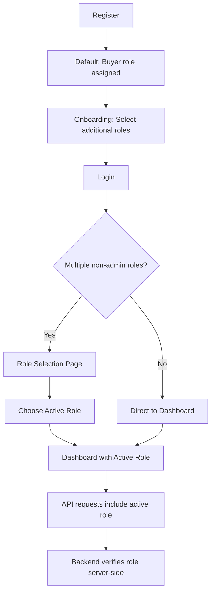
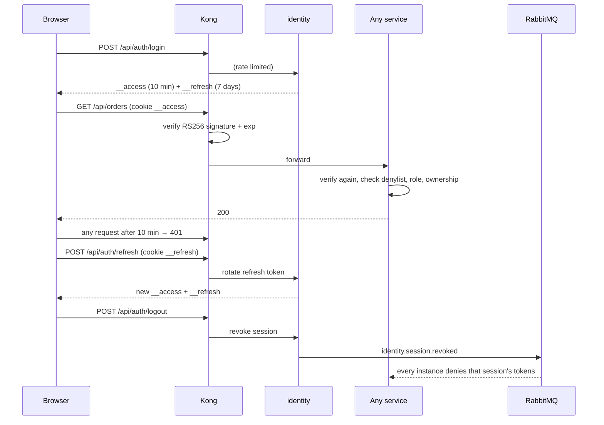
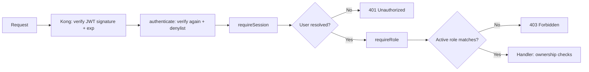

# Authentication & Role System

SEAPEDIA implements a multi-role authentication system where one user account can own multiple roles (Admin, Seller, Buyer, Driver) and switch between them per session.

## Overview

## Account Roles

| Role | Description | Access Level |
|------|-------------|--------------|
| **Admin** | Platform administrator | Full system access, monitoring, time simulation |
| **Seller** | Store owner | Store management, product CRUD, order processing |
| **Buyer** | Customer | Wallet, cart, checkout, order history |
| **Driver** | Delivery partner | Find/take/complete delivery jobs, earnings |

### Multi-Role Model

- One username may own **multiple non-admin roles** simultaneously
- Example: A user can be both a Seller and a Buyer in the same account
- After login, the user must **choose an active role** for the current session
- Authorization is based on the **active role**, not the full list of roles
- Admin role is separate from the multi-role selection flow

## Authentication Flow

### Registration

1. User submits username, email, and password
2. Password is hashed using **Bun's bcrypt** (`Bun.password.hash()`)
3. User is created with `isOnboarded: false`
4. Default `buyer` role is assigned
5. User is redirected to onboarding

### Onboarding

1. User selects which roles they want: Buyer (mandatory), Seller, Driver
2. Selected roles are created in `user_role` table
3. User is marked as `isOnboarded: true`
4. The access token is re-issued with the new roles

### Login

1. User submits username/email and password
2. Password is verified against stored bcrypt hash
3. identity opens a new **session for this device** (`sessions`) and issues:
   - an **access token**: RS256 JWT, 10 minutes, cookie `__access` (carries user id, session id, roles, active role)
   - a **refresh token**: random, stored hashed, 7 days, cookie `__refresh` (sent only to `/api/auth`)
4. If user has multiple non-admin roles → role selection page
5. If user has one role → direct to that role's dashboard

### Session Management

### Logout

1. Client calls `POST /api/auth/logout` (works even with an expired access token: the refresh cookie identifies the session)
2. identity revokes the session and publishes `identity.session.revoked`
3. Both cookies are cleared
4. Every service rejects access tokens of that session right away (denylist), until they would have expired

### Token Behavior

| Property | Access token | Refresh token |
|----------|--------------|---------------|
| Format | RS256 JWT | 256-bit random, stored as SHA-256 |
| Expiry | 10 minutes | 7 days |
| Storage | HttpOnly cookie `__access` | HttpOnly cookie `__refresh`, path `/api/auth` |
| Renewal | `POST /api/auth/refresh` | rotated on every refresh |
| Invalidated by | session revocation (denylist) or expiry | use (rotation), reuse (revokes the session), logout |

See [architecture/security.md](./architecture/security.md) for Kong, service-to-service tokens and broker permissions.

## Role-Based Access Control (RBAC)

### Middleware Chain

### Implementation

- **Kong** (`infra/kong/kong.yml.tmpl`): the jwt plugin verifies identity's RS256 access token. Routes that always need a user reject requests without a valid token; public routes let anonymous requests through.
- **`authenticate`** (`packages/platform/src/auth/middleware.ts`): every service verifies the token again (issuer, audience, expiry) and checks the session denylist, then sets `userId`, `sessionId`, `roles`, `activeRole`.
- **`requireSession`** / **`requireRole`**: 401 without a user, 403 when the active role does not match.

### Route Protection Examples

| Endpoint | Required Role | Description |
|----------|---------------|-------------|
| `GET /api/products` | None (public) | Product catalog |
| `POST /api/seller/products` | Seller | Create product |
| `GET /api/buyers/wallet` | Buyer | View wallet |
| `POST /api/driver/jobs/:id/take` | Driver | Take delivery job |
| `GET /api/admin/summary` | Admin | Dashboard stats |
| `POST /api/admin/time/simulate` | Admin | Advance time |

### Resource Ownership

- Sellers can only manage **their own store** and **their own products**
- Buyers can only view **their own orders** and **their own wallet**
- Drivers can only take **available jobs** and complete **their own taken jobs**
- Admin can access **all resources**

## API Endpoints

| Method | Endpoint | Description |
|--------|----------|-------------|
| POST | `/api/auth/register` | Register new account |
| POST | `/api/auth/login` | Login |
| POST | `/api/auth/logout` | Logout (invalidates session) |
| GET | `/api/auth/session` | Get current session info |
| POST | `/api/auth/select-role` | Switch active role |
| POST | `/api/auth/onboard` | Complete onboarding (select roles) |
| GET | `/api/auth/financial-summary` | Financial summary across roles |
| GET | `/api/private/me` | Get current user profile |

## Security Measures

1. **Password hashing**: bcrypt via Bun's native `Bun.password.hash()`
2. **HttpOnly cookies**: tokens stored in `__access` / `__refresh` cookies, not accessible via JavaScript
3. **Server-side verification**: Backend always verifies JWT signature and session existence
4. **Active role check**: Every protected endpoint verifies the active role server-side
5. **Session invalidation**: Logout deletes the session record, making old JWTs invalid
6. **No frontend trust**: UI is never trusted for access control decisions

## Code References

| Component | File |
|-----------|------|
| JWT sign/verify | `services/identity/src/lib/jwt.ts` |
| Auth middleware | `packages/platform/src/internal-auth.ts` |
| Auth service | `services/identity/src/modules/auth/auth.service.ts` |
| Auth routes | `services/identity/src/modules/auth/auth.routes.ts` |
| Frontend auth context | `apps/web/src/lib/auth/context.tsx` |
| Route guards | `apps/web/src/lib/auth/guards.ts` |
