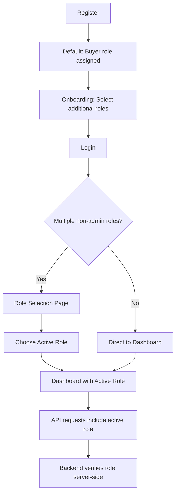
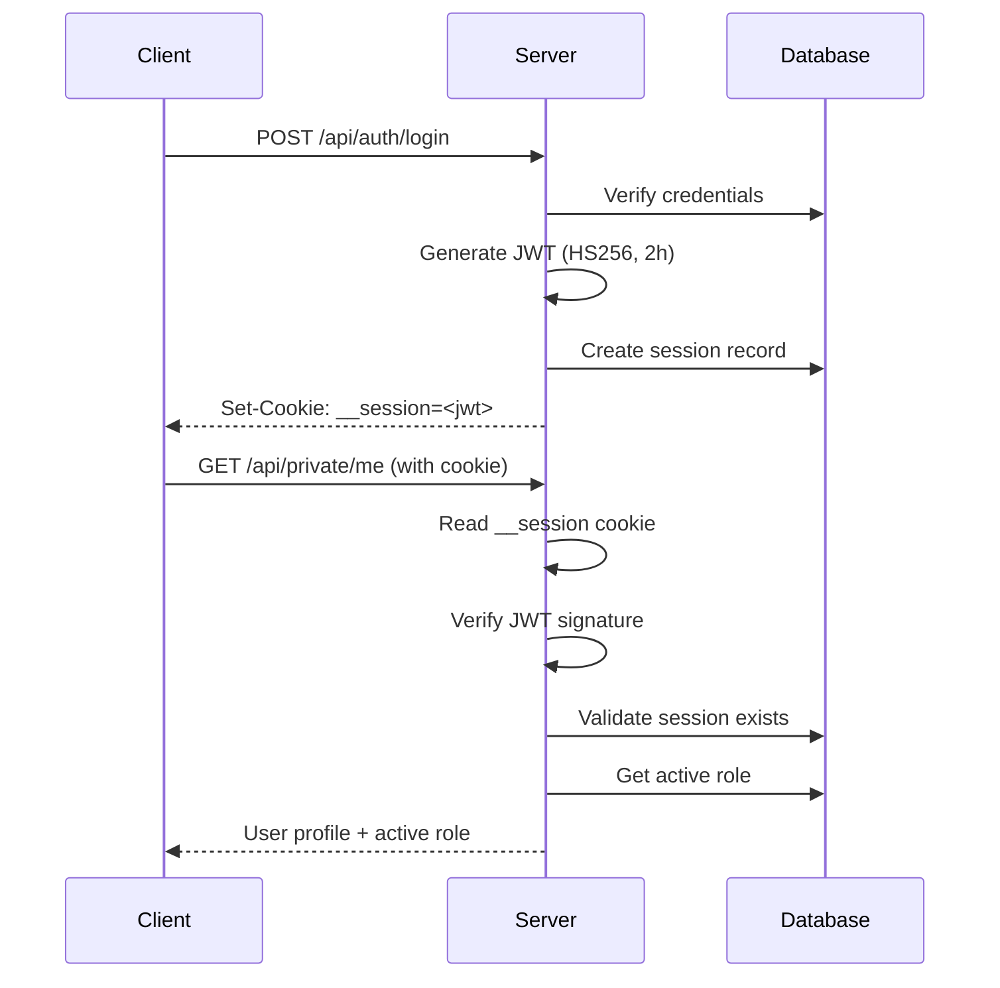
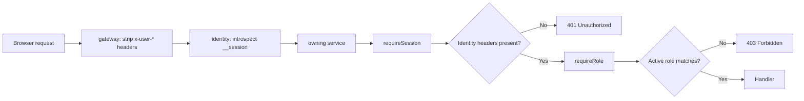

# Authentication & Role System

SEAPEDIA implements a multi-role authentication system where one user account can own multiple roles (Admin, Seller, Buyer, Driver) and switch between them per session.

## Overview

## Account Roles

| Role | Description | Access Level |
|------|-------------|--------------|
| **Admin** | Platform administrator | Full system access, monitoring, time simulation |
| **Seller** | Store owner | Store management, product CRUD, order processing |
| **Buyer** | Customer | Wallet, cart, checkout, order history |
| **Driver** | Delivery partner | Find/take/complete delivery jobs, earnings |

### Multi-Role Model

- One username may own **multiple non-admin roles** simultaneously
- Example: A user can be both a Seller and a Buyer in the same account
- After login, the user must **choose an active role** for the current session
- Authorization is based on the **active role**, not the full list of roles
- Admin role is separate from the multi-role selection flow

## Authentication Flow

### Registration

1. User submits username, email, and password
2. Password is hashed using **Bun's bcrypt** (`Bun.password.hash()`)
3. User is created with `isOnboarded: false`
4. Default `buyer` role is assigned
5. User is redirected to onboarding

### Onboarding

1. User selects which roles they want: Buyer (mandatory), Seller, Driver
2. Selected roles are created in `user_role` table
3. User is marked as `isOnboarded: true`
4. Active session is created with the primary role

### Login

1. User submits username/email and password
2. Password is verified against stored bcrypt hash
3. JWT is generated (HS256, 2-hour expiry)
4. JWT is stored in HttpOnly cookie `__session`
5. Session record is created in `active_session` table
6. If user has multiple non-admin roles → role selection page
7. If user has one role → direct to that role's dashboard

### Session Management

### Logout

1. Client calls `POST /api/auth/logout`
2. Backend deletes the session record from `active_session`
3. Cookie is cleared
4. Subsequent requests with the old JWT are rejected (session no longer exists)

### Token Behavior

| Property | Value |
|----------|-------|
| Algorithm | HS256 |
| Expiry | 2 hours |
| Storage | HttpOnly cookie `__session` |
| Renewal | New token on each login |
| Invalidated by | Session record deletion |

## Role-Based Access Control (RBAC)

### Middleware Chain

### Implementation

- **Gateway**: removes any identity headers the client sent, then resolves the `__session` cookie with identity (`POST /internal/sessions/introspect`, which verifies the JWT and that the session row still exists). The result is cached for 5 seconds and dropped whenever identity changes that session (login, logout, role switch). The gateway forwards `x-user-id`, `x-session-id`, `x-active-role` with the internal service token.
- **`requireSession`** (`packages/platform/src/internal-auth.ts`): in each service, requires those forwarded headers and sets `userId`, `sessionId`, `activeRole` in context. Services reject requests without the internal token, so the headers cannot come from a browser.
- **`requireRole`**: Checks if `activeRole` matches the endpoint's required role

### Route Protection Examples

| Endpoint | Required Role | Description |
|----------|---------------|-------------|
| `GET /api/products` | None (public) | Product catalog |
| `POST /api/seller/products` | Seller | Create product |
| `GET /api/buyers/wallet` | Buyer | View wallet |
| `POST /api/driver/jobs/:id/take` | Driver | Take delivery job |
| `GET /api/admin/summary` | Admin | Dashboard stats |
| `POST /api/admin/time/simulate` | Admin | Advance time |

### Resource Ownership

- Sellers can only manage **their own store** and **their own products**
- Buyers can only view **their own orders** and **their own wallet**
- Drivers can only take **available jobs** and complete **their own taken jobs**
- Admin can access **all resources**

## API Endpoints

| Method | Endpoint | Description |
|--------|----------|-------------|
| POST | `/api/auth/register` | Register new account |
| POST | `/api/auth/login` | Login |
| POST | `/api/auth/logout` | Logout (invalidates session) |
| GET | `/api/auth/session` | Get current session info |
| POST | `/api/auth/select-role` | Switch active role |
| POST | `/api/auth/onboard` | Complete onboarding (select roles) |
| GET | `/api/auth/financial-summary` | Financial summary across roles |
| GET | `/api/private/me` | Get current user profile |

## Security Measures

1. **Password hashing**: bcrypt via Bun's native `Bun.password.hash()`
2. **HttpOnly cookies**: JWT stored in `__session` cookie, not accessible via JavaScript
3. **Server-side verification**: Backend always verifies JWT signature and session existence
4. **Active role check**: Every protected endpoint verifies the active role server-side
5. **Session invalidation**: Logout deletes the session record, making old JWTs invalid
6. **No frontend trust**: UI is never trusted for access control decisions

## Code References

| Component | File |
|-----------|------|
| JWT sign/verify | `services/identity/src/lib/jwt.ts` |
| Auth middleware | `packages/platform/src/internal-auth.ts` |
| Auth service | `services/identity/src/modules/auth/auth.service.ts` |
| Auth routes | `services/identity/src/modules/auth/auth.routes.ts` |
| Frontend auth context | `apps/web/src/lib/auth/context.tsx` |
| Route guards | `apps/web/src/lib/auth/guards.ts` |
