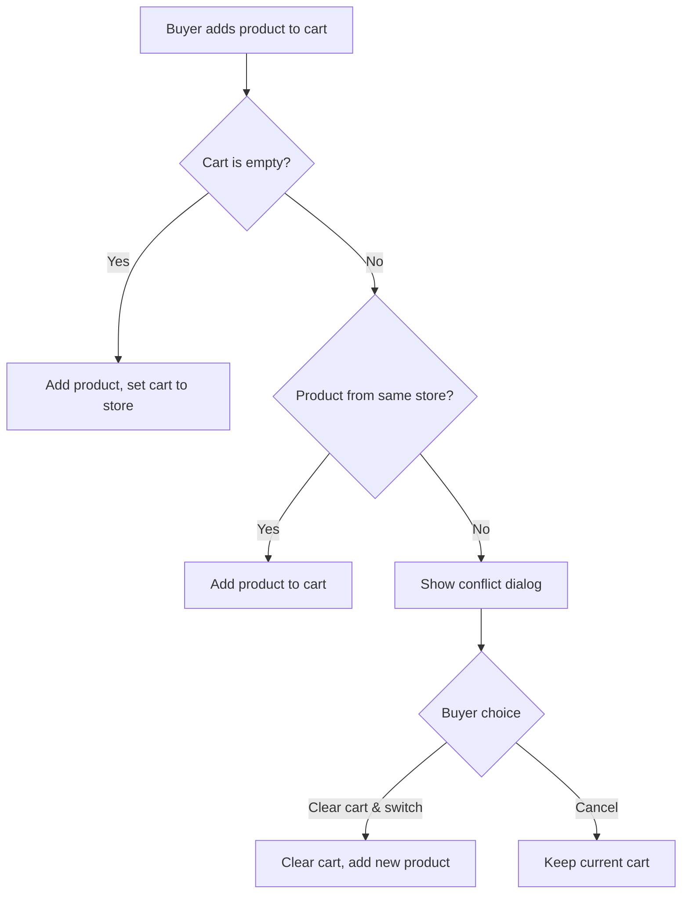

# Core Business Rules

This document defines the fundamental business rules that govern SEAPEDIA's marketplace behavior. These rules apply across multiple levels and must be reflected consistently in both frontend and backend.

## Single-Store Checkout Rule

SEAPEDIA is a multi-seller marketplace, but each cart may only contain products from **one store** at a time.

### Behavior



### Rules

1. A cart is scoped to a single store (`carts.storeId`)
2. If a buyer tries to add a product from a different store, the system shows a confirmation dialog
3. The buyer can choose to clear the cart and switch to the new store
4. The buyer can also cancel and keep the current cart
5. This rule is enforced on both **frontend** (UI guard) and **backend** (API validation)

### Implementation

- Frontend: `frontend/src/features/buyer/` — cart components check store before add
- Backend: `backend/src/modules/buyers/buyers-cart.service.ts` — validates storeId matches

## Financial Calculation

### Checkout Formula

```
deliveryFee = { instant: 30000, next_day: 15000, regular: 10000 }
discountedSubtotal = max(0, subtotal - discountAmount)
taxBase = discountedSubtotal + deliveryFee
ppn = round(taxBase * 0.12)
totalAmount = taxBase + ppn
```

### Calculation Order

1. **Subtotal** — Sum of (price × quantity) for all cart items
2. **Discount** — Applied from Voucher or Promo code (cannot be combined)
3. **Delivery Fee** — Based on selected delivery method
4. **PPN 12%** — Applied to (discounted subtotal + delivery fee)
5. **Final Total** — Tax base + PPN

### Example

```
Cart: Samsung Galaxy A15 (Rp 2,899,000) × 1
Discount: HEMAT25K (Rp 25,000 voucher)
Delivery: Instant (Rp 30,000)

subtotal          = 2,899,000
discountAmount    = 25,000
discountedSubtotal = 2,874,000
deliveryFee       = 30,000
taxBase           = 2,874,000 + 30,000 = 2,904,000
ppn               = round(2,904,000 × 0.12) = 348,480
totalAmount       = 2,904,000 + 348,480 = 3,252,480
```

### Code Reference

- `backend/src/modules/orders/orders-checkout.service.ts:25-31` — `calculateTotals()`

## Delivery Methods

| Method | Delivery Fee | SLA |
|--------|-------------|-----|
| Instant | Rp 30,000 | 2 hours |
| Next Day | Rp 15,000 | 24 hours |
| Regular | Rp 10,000 | 48 hours |

- Delivery fee is set during checkout based on the selected method
- The delivery fee is paid by the Buyer as part of the total
- The delivery fee is earned 100% by the Driver upon job completion

## Driver Earning Rule

Drivers earn **100% of the delivery fee** for each completed delivery.

- The delivery fee is stored on the `deliveryJobs` record at creation time
- Upon job completion, the delivery fee is credited to the driver's earnings
- Earnings are calculated as the sum of `deliveryFee` from all completed delivery jobs
- The earning amount is displayed in the job detail view before the driver accepts

### Code Reference

- `backend/src/modules/driver/driver.service.ts:165-171` — earnings calculation

## Seller Income Rule

- Seller income is calculated as the sum of `subtotal` from fully completed (`pesanan_selesai`) orders
- Delivery fees, PPN, and other checkout components are **excluded** from seller income
- Refunded or returned orders are **not counted** as seller income
- If seller income was already recorded, a reversal transaction is created

### Code Reference

- `backend/src/modules/orders/orders-seller.service.ts` — income report

## Buyer Spending Rule

- Buyer spending is calculated as the sum of `totalAmount` from fully completed (`pesanan_selesai`) orders
- This excludes cancelled, refunded, or returned orders
- The spending report shows the total amount deducted from the buyer's wallet

### Code Reference

- `backend/src/modules/orders/orders-buyer.service.ts` — expense report

## Wallet Rules

- Every non-admin user has a wallet with a balance
- Balance is stored in IDR (integer, no decimals)
- Top-up is a dummy simulation — balance is credited immediately
- Wallet is charged during checkout
- Refunds from overdue orders are credited back to the wallet
- Wallet transaction history records all top-ups, payments, and refunds

### Transaction Types

| Type | Description |
|------|-------------|
| `topup` | Balance credited (dummy simulation) |
| `payment` | Balance deducted (checkout) |
| `refund` | Balance credited (overdue return) |

## Order Status Rules

See [ORDER-LIFECYCLE.md](./ORDER-LIFECYCLE.md) for the complete order lifecycle.

### Key Rules

1. Initial order status after checkout: `sedang_dikemas`
2. Seller must process the order before a Driver can take it
3. Only one Driver can take a job at a time
4. Every status change is recorded with a timestamp in `order_status_history`
5. Overdue orders are automatically moved to `dikembalikan`

## Discount Rules

See [DISCOUNTS.md](./DISCOUNTS.md) for the complete discount system.

### Key Rules

1. Voucher and Promo **cannot be combined** in a single checkout
2. If both are provided, the system applies the **higher-value discount**
3. Expired or fully-used discounts cannot be applied
4. Discount is applied **before** PPN calculation
5. Discount is reflected in the checkout summary

## Store Rules

1. Store names must be **unique** across the platform
2. A Seller may only manage **their own store**
3. Uniqueness is enforced via database constraints and backend validation
4. Store slug is auto-generated from the store name

## Product Rules

1. Products must belong to a store
2. A Seller may only create/update/delete products under **their own store**
3. Product stock must be non-negative
4. Stock is reduced during checkout
5. Stock is restored during overdue refund
6. `soldCount` is incremented when a delivery job is completed

## Public Content Rules

1. Application reviews are about the **platform experience**, not specific products
2. Guests may submit application reviews
3. Product reviews are only available to buyers who completed an order
4. One review per buyer per product (unique constraint)
5. All user-generated content must be rendered safely (XSS prevention)
