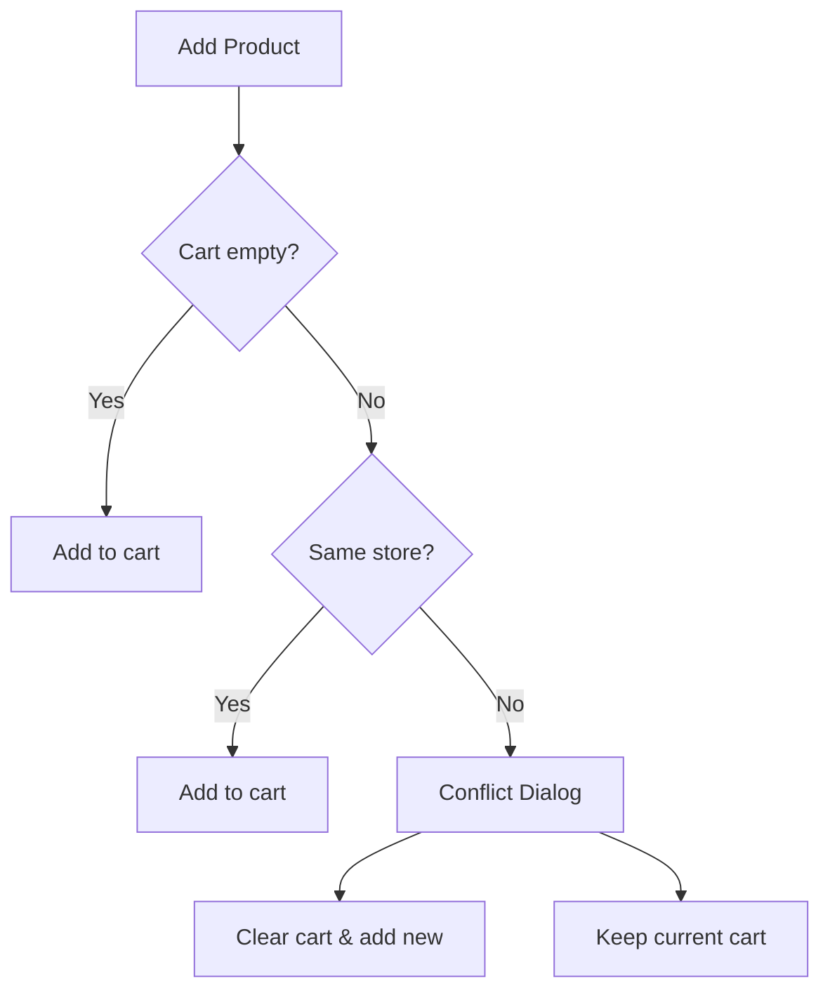
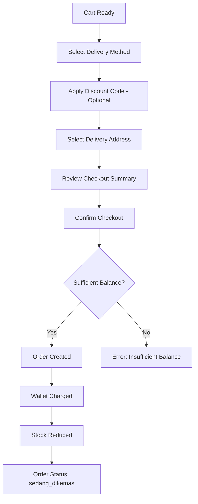

# Buyer Flow

Buyers are customers who browse products, manage their wallet, build carts, and checkout.

## Buyer Dashboard

After selecting the Buyer role, the buyer accesses the Buyer Dashboard with these sections:

| Section | Description |
|---------|-------------|
| Wallet | Balance, top-up, transaction history |
| Addresses | Delivery address management |
| Cart | Shopping cart (single-store) |
| Orders | Order history and details |
| Reports | Spending summary |

## Wallet Management

### Top Up

1. Navigate to Wallet section
2. Enter amount (or select preset)
3. Click "Top Up"
4. Balance is credited immediately (dummy simulation)
5. Transaction recorded in wallet history

### Wallet Balance

- Displayed prominently in the dashboard
- Used for checkout payment
- Cannot checkout if balance is insufficient

### Transaction History

Shows all wallet transactions:

| Type | Description |
|------|-------------|
| `topup` | Balance credited |
| `payment` | Balance deducted (checkout) |
| `refund` | Balance credited (overdue return) |

Each transaction shows: amount, type, status, reference, timestamp.

## Address Management

### Add Address

1. Navigate to Addresses section
2. Click "Add Address"
3. Fill in: label, recipient name, phone, province, city, district, postal code, full address
4. Set as default (optional)
5. Save

### Address Fields

| Field | Description |
|-------|-------------|
| Label | E.g., "Home", "Office" |
| Recipient Name | Name of the person receiving |
| Phone | Contact phone number |
| Province | Indonesian province |
| City | City/regency |
| District | District/sub-district |
| Postal Code | 5-digit postal code |
| Full Address | Detailed street address |
| Default | Whether this is the default address |

### Address Rules

- Buyer can have multiple addresses
- One address can be set as default
- Default address is used for checkout
- Address is snapshotted at checkout time

## Cart Management

### Adding Products

1. Browse products in the catalog
2. Click "Add to Cart" on a product
3. If cart is empty → product is added
4. If cart has items from the same store → product is added
5. If cart has items from a different store → conflict dialog appears

### Single-Store Checkout



### Cart Operations

- Update quantity of items
- Remove individual items
- Clear entire cart
- View cart summary (items, subtotal, store info)

### Cart Rules

- One cart per buyer
- Cart is scoped to one store
- Stock validation on add (cannot exceed available stock)

## Checkout

### Checkout Flow



### Checkout Summary

The checkout page displays:

| Line Item | Description |
|-----------|-------------|
| Subtotal | Sum of item prices |
| Discount | Applied voucher/promo (if any) |
| Delivery Fee | Based on delivery method |
| PPN 12% | Tax on (discounted subtotal + delivery fee) |
| **Total** | Final amount charged |

### Delivery Methods

| Method | Fee | SLA |
|--------|-----|-----|
| Instant | Rp 30,000 | 2 hours |
| Next Day | Rp 15,000 | 24 hours |
| Regular | Rp 10,000 | 48 hours |

### Checkout Rules

- Wallet balance must be sufficient
- Stock must be available for all items
- Only one store's products per checkout
- Discount code is validated during checkout
- Address is snapshotted (changes after checkout don't affect existing orders)

## Order History

### Order List

Shows all buyer's orders with:
- Order ID
- Store name
- Total amount
- Status
- Created date

### Order Detail

Shows complete order information:
- Items (name, price, quantity)
- Financial breakdown (subtotal, discount, delivery fee, PPN, total)
- Delivery method
- Delivery address
- Status timeline with timestamps

### Status Tracking

Buyers can track order progress:

```
sedang_dikemas → menunggu_pengirim → sedang_dikirim → pesanan_selesai
```

Each status shows a timestamp and note.

## Spending Report

The buyer spending report shows:
- Total spending from completed orders
- Breakdown by order
- Only counts `pesanan_selesai` orders
- Uses `totalAmount` (includes delivery fee and PPN)

### Calculation

```
Buyer Spending = Σ (order.totalAmount) for orders where status = 'pesanan_selesai'
```

## API Endpoints

| Method | Endpoint | Description |
|--------|----------|-------------|
| GET | `/api/buyers/wallet` | Get wallet balance |
| POST | `/api/buyers/wallet/topup` | Top up wallet |
| GET | `/api/buyers/wallet/transactions` | Wallet transaction history |
| GET | `/api/buyers/addresses` | List addresses |
| POST | `/api/buyers/addresses` | Create address |
| PUT | `/api/buyers/addresses/:id` | Update address |
| DELETE | `/api/buyers/addresses/:id` | Delete address |
| GET | `/api/buyers/cart` | Get cart summary |
| POST | `/api/buyers/cart/items` | Add item to cart |
| PUT | `/api/buyers/cart/items/:productId` | Update item quantity |
| DELETE | `/api/buyers/cart/items/:productId` | Remove item from cart |
| DELETE | `/api/buyers/cart` | Clear cart |
| POST | `/api/buyers/checkout/preview` | Preview checkout |
| POST | `/api/buyers/checkout` | Create order |
| GET | `/api/orders` | Order history |
| GET | `/api/orders/:orderId` | Order detail |
| GET | `/api/orders/report` | Spending report |

## Code References

| Component | File |
|-----------|------|
| Buyer service | `services/commerce/src/modules/buyers/buyers.service.ts` |
| Cart service | `services/commerce/src/modules/buyers/buyers-cart.service.ts` |
| Checkout service | `services/commerce/src/modules/orders/orders-checkout.service.ts` |
| Buyer order service | `services/commerce/src/modules/orders/orders-buyer.service.ts` |
| Buyer routes | `services/commerce/src/modules/buyers/buyers.routes.ts` |
| Frontend buyer features | `apps/web/src/features/buyer/` |
