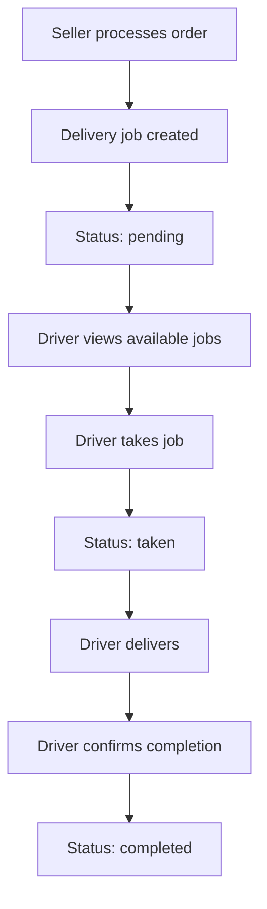
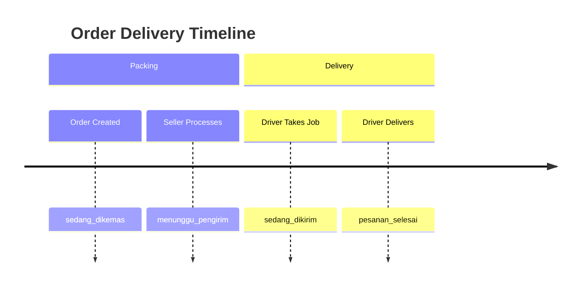

# Delivery System

SEAPEDIA supports three delivery methods with different fees and SLAs. Delivery jobs are created when sellers process orders and are picked up by drivers.

## Delivery Methods

| Method | Key | Delivery Fee | SLA |
|--------|-----|-------------|-----|
| Instant | `instant` | Rp 30,000 | 2 hours |
| Next Day | `next_day` | Rp 15,000 | 24 hours |
| Regular | `regular` | Rp 10,000 | 48 hours |

## Delivery Job Lifecycle



### Job Creation

- Triggered when seller processes an order (`POST /api/seller/orders/:orderId/process`)
- Delivery job is created with `status: 'pending'`
- Delivery fee is copied from the order
- Job is linked to the order via `orderId`

### Job Assignment

- Drivers view available jobs (`GET /api/driver/jobs/available`)
- Only jobs with `status: 'pending'` and order `status: 'menunggu_pengirim'` are shown
- Driver clicks "Take Job" to claim it
- System uses `FOR UPDATE` lock to prevent race conditions
- Job status → `taken`, `driverId` is set
- Order status → `sedang_dikirim`

### Job Completion

- Driver clicks "Complete Delivery"
- Job status → `completed`
- Order status → `pesanan_selesai`
- Product `soldCount` is incremented
- Status history entry is created

## Driver Earning Rule

Drivers earn **100% of the delivery fee**.

```
Driver Earnings = Σ (deliveryJobs.deliveryFee) for completed jobs
```

### Earning Display

The earning amount is shown in the job detail view **before** the driver accepts the job. This allows drivers to make informed decisions about which jobs to take.

## Delivery Job Data Model

```typescript
{
  id: string,              // UUID
  orderId: string,         // FK → orders (unique)
  driverId: string | null, // FK → users (set when taken)
  status: string,          // 'pending' | 'taken' | 'completed'
  deliveryFee: number,     // Copied from order
  createdAt: Date,
  updatedAt: Date
}
```

## Concurrency Safety

### Race Condition Prevention

When a driver takes a job, the system:

1. Uses a database transaction
2. Applies `FOR UPDATE` lock on the delivery job row
3. Checks `status: 'pending'` in the `WHERE` clause
4. If the row was already taken by another driver, the update returns no rows
5. A `ConflictError` is thrown if the job is unavailable

```typescript
const [job] = await tx
  .update(deliveryJobs)
  .set({ status: 'taken', driverId, updatedAt: new Date() })
  .where(and(eq(deliveryJobs.id, jobId), eq(deliveryJobs.status, 'pending')))
  .returning();
if (!job) throw new ConflictError('Delivery job unavailable');
```

### Deadlock Prevention

When completing a job and incrementing `soldCount`, items are sorted by `productId` to prevent deadlocks during bulk updates:

```typescript
const sortedItems = [...items].sort((a, b) => {
  if (!a.productId) return 1;
  if (!b.productId) return -1;
  return a.productId.localeCompare(b.productId);
});
```

## Delivery Tracking

Buyers and sellers can track delivery status through the order timeline:



## API Endpoints

| Method | Endpoint | Access | Description |
|--------|----------|--------|-------------|
| GET | `/api/driver/jobs/available` | Driver | List available jobs |
| GET | `/api/driver/jobs/:jobId` | Driver | Job detail with items |
| POST | `/api/driver/jobs/:jobId/take` | Driver | Take a job |
| POST | `/api/driver/jobs/:jobId/complete` | Driver | Complete a job |
| GET | `/api/driver/stats` | Driver | Earnings and stats |
| GET | `/api/driver/history` | Driver | Completed job history |

## Code References

| Component | File |
|-----------|------|
| Driver service | `services/commerce/src/modules/driver/driver.service.ts` |
| Driver routes | `services/commerce/src/modules/driver/driver.routes.ts` |
| Delivery schema | `services/commerce/src/db/schema/delivery-schema.ts` |
| Seller order processing (creates job) | `services/commerce/src/modules/orders/orders-seller.service.ts` |
| Frontend driver features | `apps/web/src/features/driver/` |
