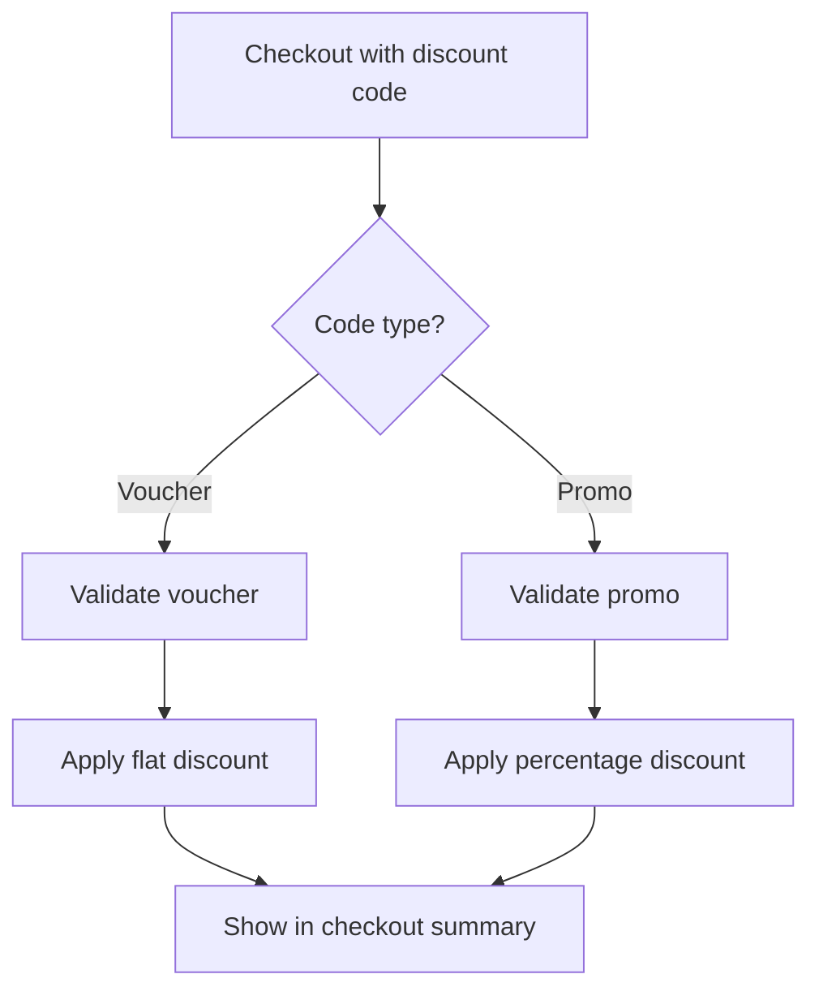

# Discount System

SEAPEDIA supports two types of discounts: **Vouchers** and **Promos**. Both are managed by Admin and applied during buyer checkout.

## Discount Types

### Voucher

| Property | Description |
|----------|-------------|
| Type | Flat amount discount (e.g., Rp 10,000 off) |
| Code | Unique alphanumeric code |
| Discount Amount | Fixed IDR amount |
| Min Order | Minimum subtotal required |
| Expiry | Date when voucher expires |
| Remaining Usage | Number of times it can still be used |

### Promo

| Property | Description |
|----------|-------------|
| Type | Percentage discount with cap |
| Code | Unique alphanumeric code |
| Discount Percent | 1-100% |
| Max Discount | Maximum discount amount (cap) |
| Min Order | Minimum subtotal required |
| Expiry | Date when promo expires |
| Usage Limit | Unlimited |

## Combination Rules

**Voucher and Promo cannot be combined** in a single checkout.



### Conflict Resolution

If a buyer provides both a Voucher and Promo code, the system applies the one with the **higher discount value**.

## Discount Calculation

### Voucher

```
discountAmount = voucher.discountAmount
```

### Promo

```
discountAmount = min(subtotal × promo.discountPercent / 100, promo.maxDiscount)
```

### Example

```
Subtotal: Rp 1,000,000
Promo: 10% off, max Rp 50,000

discountAmount = min(1,000,000 × 10/100, 50,000)
               = min(100,000, 50,000)
               = 50,000
```

## Validation Rules

A discount code is valid if:

1. **Code exists** in the database
2. **Not expired** — `expiresAt > now`
3. **Has remaining usage** (vouchers only) — `remainingUsage > 0`
4. **Meets minimum order** — `subtotal >= minOrderAmount`
5. **Correct type** — matches what was applied

### Invalid Discount Responses

| Error | Description |
|-------|-------------|
| Code not found | No voucher/promo with that code |
| Expired | Discount has passed its expiry date |
| No remaining usage | Voucher has been fully used |
| Minimum not met | Cart subtotal is below the minimum |

## Checkout Integration

### Preview

The checkout preview endpoint shows the discount effect:

```json
{
  "subtotal": 1000000,
  "discountAmount": 50000,
  "discountCode": "HEMAT25K",
  "discountType": "voucher",
  "deliveryFee": 30000,
  "taxBase": 980000,
  "ppn": 117600,
  "totalAmount": 1097600
}
```

### Calculation Order

```
1. Subtotal = Σ (price × quantity)
2. Discount = validated discount amount
3. Discounted Subtotal = max(0, subtotal - discount)
4. Delivery Fee = based on delivery method
5. Tax Base = Discounted Subtotal + Delivery Fee
6. PPN = round(Tax Base × 0.12)
7. Total = Tax Base + PPN
```

## Admin Management

### Create Voucher

| Field | Required | Description |
|-------|----------|-------------|
| code | Yes | Unique code (auto-uppercased) |
| discountAmount | Yes | Flat discount in IDR |
| minOrderAmount | Yes | Minimum order subtotal |
| expiresAt | Yes | Expiry date |
| remainingUsage | Yes | How many times it can be used |

### Create Promo

| Field | Required | Description |
|-------|----------|-------------|
| code | Yes | Unique code (auto-uppercased) |
| discountPercent | Yes | 1-100% |
| maxDiscountAmount | No | Cap on discount (null = no cap) |
| minOrderAmount | Yes | Minimum order subtotal |
| expiresAt | Yes | Expiry date |

## Seed Data

After running `bun run db:seed`, the following discount codes are available:

### Vouchers

| Code | Amount | Min Order | Remaining |
|------|--------|-----------|-----------|
| `HEMAT10K` | Rp 10,000 | Rp 50,000 | 45 |
| `HEMAT25K` | Rp 25,000 | Rp 100,000 | 70 |
| `HEMAT50K` | Rp 50,000 | Rp 200,000 | 85 |
| `GRATIS100K` | Rp 100,000 | Rp 500,000 | 95 |
| `NEWUSER15K` | Rp 15,000 | Rp 75,000 | 60 |
| `FLASH20K` | Rp 20,000 | Rp 150,000 | 30 |
| `WEEKEND30K` | Rp 30,000 | Rp 250,000 | 50 |
| `BONUS5K` | Rp 5,000 | Rp 25,000 | 80 |

### Promos

| Code | Percent | Max Discount | Min Order |
|------|---------|-------------|-----------|
| `PROMO10` | 10% | Rp 50,000 | Rp 100,000 |
| `PROMO20` | 20% | Rp 75,000 | Rp 200,000 |
| `MEGA25` | 25% | Rp 100,000 | Rp 300,000 |
| `SALE15` | 15% | Rp 40,000 | Rp 75,000 |

## API Endpoints

| Method | Endpoint | Access | Description |
|--------|----------|--------|-------------|
| GET | `/api/discounts` | Public | List available discounts |
| POST | `/api/discounts/validate` | Buyer | Validate a discount code |
| GET | `/api/admin/vouchers` | Admin | List all vouchers |
| POST | `/api/admin/vouchers` | Admin | Create voucher |
| GET | `/api/admin/vouchers/:id` | Admin | Voucher detail |
| GET | `/api/admin/promos` | Admin | List all promos |
| POST | `/api/admin/promos` | Admin | Create promo |
| GET | `/api/admin/promos/:id` | Admin | Promo detail |

## Code References

| Component | File |
|-----------|------|
| Discount service | `services/commerce/src/modules/discounts/discounts.service.ts` |
| Discount routes | `services/commerce/src/modules/discounts/discounts.routes.ts` |
| Discount schemas | `services/commerce/src/modules/discounts/discounts.schemas.ts` |
| Discount schema | `services/commerce/src/db/schema/discount-schema.ts` |
| Checkout integration | `services/commerce/src/modules/orders/orders-checkout.service.ts:65-73` |
