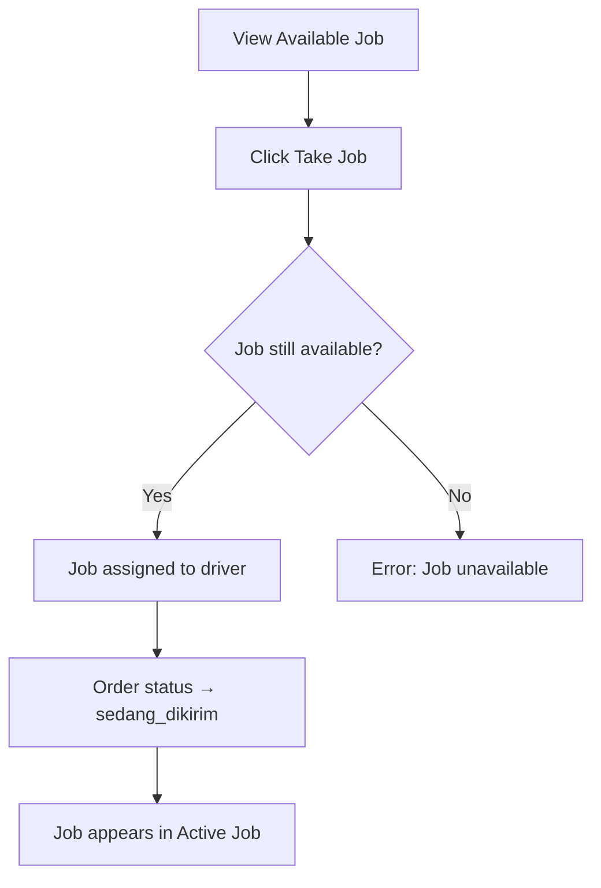
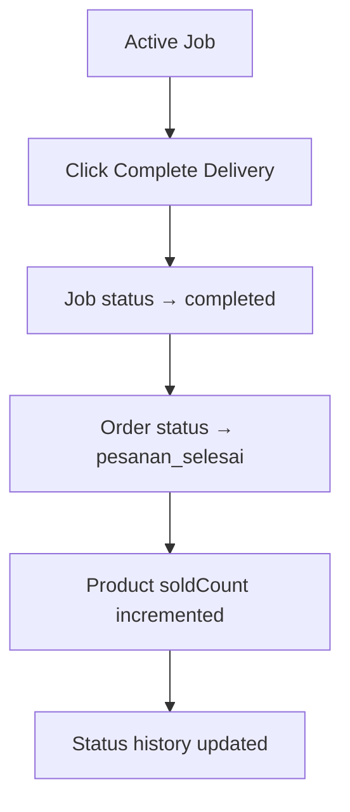
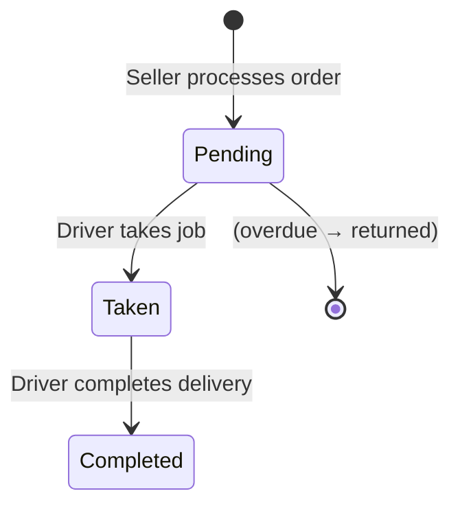

# Driver Flow

Drivers are delivery partners who find available jobs, take deliveries, and confirm completion.

## Driver Dashboard

After selecting the Driver role, the driver accesses the Driver Dashboard with these sections:

| Section | Description |
|---------|-------------|
| Active Job | Current delivery in progress |
| Available Jobs | Jobs waiting to be taken |
| Job History | Completed deliveries |
| Earnings | Total earnings and breakdown |

## Finding Jobs

### Available Jobs

1. Navigate to Available Jobs section
2. View list of jobs with status `pending`
3. Each job shows:
   - Store name
   - Delivery method
   - Delivery address
   - Delivery fee (earnings)
   - Order items

### Job Eligibility

- Only jobs with status `pending` and order status `menunggu_pengirim` are shown
- Jobs are created when sellers process orders
- Maximum 50 jobs displayed at once

## Taking a Job

### Flow



### Rules

- Only one driver can take a job at a time
- Uses database-level locking (`FOR UPDATE`) to prevent race conditions
- Driver cannot take a job they already took
- Driver cannot take a job that's already taken by another driver

## Completing a Job

### Flow



### Rules

- Only the driver who took the job can complete it
- Job must be in `taken` status
- Order must be in `sedang_dikirim` status
- Completion triggers `soldCount` increment on products

## Job History

Shows all completed deliveries:
- Store name
- Delivery method
- Delivery address
- Delivery fee (earnings)
- Completion timestamp

Paginated with 10 items per page.

## Earnings

### Calculation

```
Total Earnings = Σ (deliveryJobs.deliveryFee) for jobs where status = 'completed'
```

### Driver Stats

| Metric | Description |
|--------|-------------|
| Total Earnings | Sum of delivery fees from completed jobs |
| Completed Jobs | Count of completed deliveries |
| Active Jobs | Currently assigned jobs |

### Earning Rule

- Drivers earn **100% of the delivery fee**
- The delivery fee is set during buyer checkout
- Earning is displayed in job detail before accepting

## Delivery Job Lifecycle



## API Endpoints

| Method | Endpoint | Description |
|--------|----------|-------------|
| GET | `/api/driver/jobs/available` | List available jobs |
| GET | `/api/driver/jobs/:jobId` | Get job detail |
| POST | `/api/driver/jobs/:jobId/take` | Take a job |
| POST | `/api/driver/jobs/:jobId/complete` | Complete a job |
| GET | `/api/driver/stats` | Driver stats and earnings |
| GET | `/api/driver/history` | Job history (paginated) |

## Code References

| Component | File |
|-----------|------|
| Driver service | `backend/src/modules/driver/driver.service.ts` |
| Driver routes | `backend/src/modules/driver/driver.routes.ts` |
| Delivery job schema | `backend/src/db/schema/delivery-schema.ts` |
| Frontend driver features | `frontend/src/features/driver/` |
