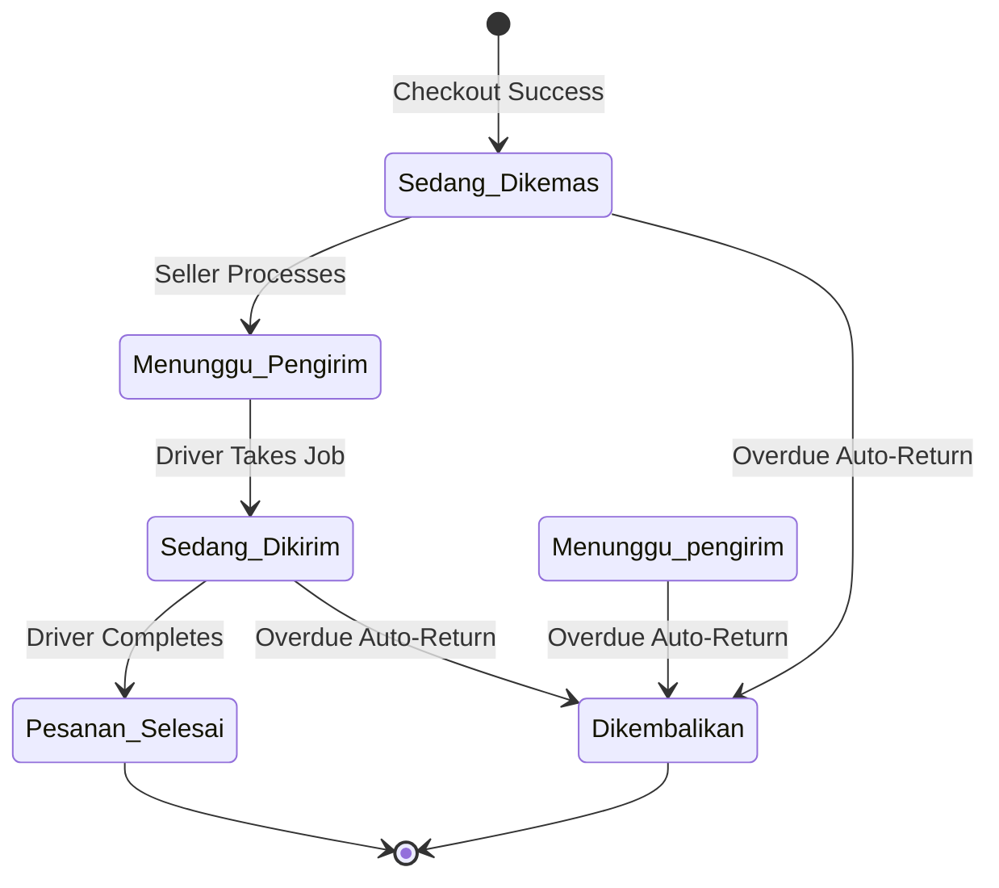

# Order Lifecycle

SEAPEDIA's order lifecycle tracks an order from creation to completion (or return). Every status change is recorded with a timestamp in the `order_status_history` table.

## Status Flow



## Status Definitions

| Status (Indonesian) | Status (Key) | English Translation | Description |
|---------------------|--------------|---------------------|-------------|
| Sedang Dikemas | `sedang_dikemas` | Being Packed | Order created, waiting for seller to process |
| Menunggu Pengirim | `menunggu_pengirim` | Waiting for Sender | Seller processed, waiting for driver to take |
| Sedang Dikirim | `sedang_dikirim` | Being Delivered | Driver has taken the job, in transit |
| Pesanan Selesai | `pesanan_selesai` | Order Completed | Delivery confirmed, order finalized |
| Dikembalikan | `dikembalikan` | Returned | Overdue auto-return, refund issued |

## Transition Rules

### 1. Checkout → Sedang Dikemas

- **Trigger**: Buyer completes checkout
- **Actor**: System (automatic)
- **Actions**:
  - Order is created with `status: 'sedang_dikemas'`
  - Wallet is charged
  - Product stock is reduced
  - Status history entry is created
  - Delivery job is **NOT** created yet

### 2. Sedang Dikemas → Menunggu Pengirim

- **Trigger**: Seller processes the order
- **Actor**: Seller
- **API**: `POST /api/seller/orders/:orderId/process`
- **Actions**:
  - Order status is updated to `menunggu_pengirim`
  - Delivery job is created with `status: 'pending'`
  - Status history entry is created
- **Constraint**: Only the seller who owns the order can process it

### 3. Menunggu Pengirim → Sedang Dikirim

- **Trigger**: Driver takes the delivery job
- **Actor**: Driver
- **API**: `POST /api/driver/jobs/:jobId/take`
- **Actions**:
  - Delivery job status → `taken`, driverId is set
  - Order status → `sedang_dikirim`
  - Status history entry is created
- **Constraint**: Only one driver can take a job (uses `FOR UPDATE` lock)

### 4. Sedang Dikirim → Pesanan Selesai

- **Trigger**: Driver confirms delivery completion
- **Actor**: Driver
- **API**: `POST /api/driver/jobs/:jobId/complete`
- **Actions**:
  - Delivery job status → `completed`
  - Order status → `pesanan_selesai`
  - Product `soldCount` is incremented
  - Status history entry is created
- **Constraint**: Only the driver who took the job can complete it

### 5. Any Active Status → Dikembalikan

- **Trigger**: Order exceeds delivery SLA
- **Actor**: System (automatic via Admin time simulation)
- **API**: `POST /api/admin/time/simulate` (triggers overdue check)
- **Actions**:
  - Order status → `dikembalikan`
  - Buyer wallet is refunded (full `totalAmount`)
  - Product stock is restored
  - Status history entry is created
- **Constraint**: Only applies to orders not yet `pesanan_selesai` or `dikembalikan`

## Status History

Every status change creates a record in `order_status_history`:

```typescript
{
  orderId: string,
  status: string,        // The new status
  note: string,          // Human-readable description
  createdAt: Date        // Timestamp of the change
}
```

### Sample History for a Completed Order

| # | Status | Note | Timestamp |
|---|--------|------|-----------|
| 1 | `sedang_dikemas` | Order successfully created. Payment completed via wallet. | 2025-01-15 10:00 |
| 2 | `menunggu_pengirim` | Pesanan sedang diproses oleh penjual. | 2025-01-15 11:30 |
| 3 | `sedang_dikirim` | Driver is delivering your order | 2025-01-15 12:00 |
| 4 | `pesanan_selesai` | Order has been delivered successfully | 2025-01-15 13:45 |

### Sample History for an Overdue Order

| # | Status | Note | Timestamp |
|---|--------|------|-----------|
| 1 | `sedang_dikemas` | Order successfully created. Payment completed via wallet. | 2025-01-15 10:00 |
| 2 | `dikembalikan` | Auto-returned: exceeded delivery SLA for instant. Refund issued. | 2025-01-15 12:01 |

## Order Data Model

```typescript
{
  id: string,                    // UUID
  buyerId: string,               // FK → users
  storeId: string,               // FK → stores
  deliveryMethod: string,        // 'instant' | 'next_day' | 'regular'
  subtotal: number,              // Sum of item prices
  discountAmount: number,        // Applied discount
  discountCode: string | null,   // Voucher/Promo code used
  discountType: string | null,   // 'voucher' | 'promo'
  deliveryFee: number,           // Based on delivery method
  ppn: number,                   // 12% tax
  totalAmount: number,           // Final charged amount
  status: string,                // Current status
  addressSnapshot: string,       // JSON of delivery address at checkout
  createdAt: Date,
  updatedAt: Date
}
```

## Order Items

Each order contains one or more items:

```typescript
{
  id: string,
  orderId: string,          // FK → orders
  productId: string | null, // FK → products (set null on delete)
  productName: string,      // Snapshot of product name
  productPrice: number,     // Snapshot of product price
  quantity: number,
  createdAt: Date
}
```

## Delivery Job Relationship

After the seller processes an order, a delivery job is created:

```typescript
{
  id: string,
  orderId: string,          // FK → orders (unique)
  driverId: string | null,  // FK → users (set when driver takes job)
  status: string,           // 'pending' | 'taken' | 'completed'
  deliveryFee: number,      // Copied from order at creation
  createdAt: Date,
  updatedAt: Date
}
```

## Code References

| Component | File |
|-----------|------|
| Checkout (creates order) | `services/commerce/src/modules/orders/orders-checkout.service.ts` |
| Seller processing | `services/commerce/src/modules/orders/orders-seller.service.ts` |
| Driver take/complete | `services/commerce/src/modules/driver/driver.service.ts` |
| Overdue processing | `services/commerce/src/modules/admin/admin.service.ts` |
| Order status schema | `services/commerce/src/db/schema/order-schema.ts` |
| Delivery job schema | `services/commerce/src/db/schema/delivery-schema.ts` |
