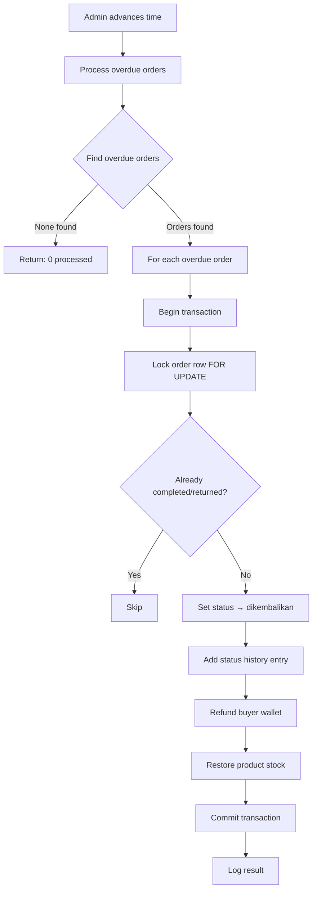
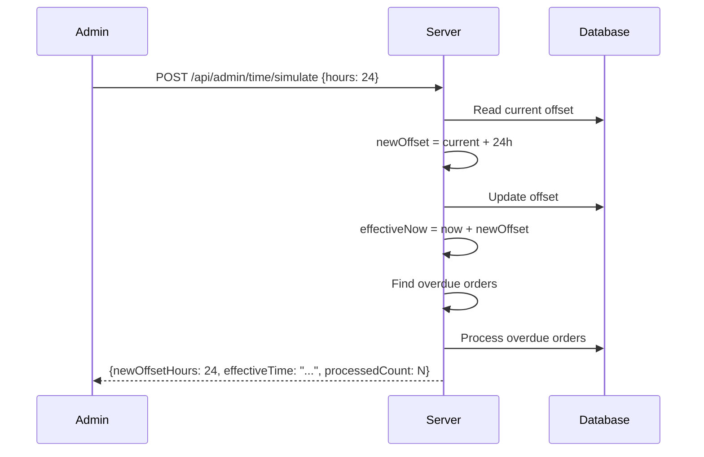

# Overdue Handling & Time Simulation

SEAPEDIA implements automatic overdue handling for orders that exceed their delivery SLA. The system uses a simulated time mechanism for demo purposes.

## Overdue Detection

### SLA Thresholds

| Delivery Method | SLA | Overdue After |
|-----------------|-----|---------------|
| Instant | 2 hours | Order created > 2 hours ago |
| Next Day | 24 hours | Order created > 24 hours ago |
| Regular | 48 hours | Order created > 48 hours ago |

### Detection Logic

The system checks for orders that:

1. Are **not** in `pesanan_selesai` (completed) or `dikembalikan` (returned) status
2. Were created **before** `effectiveNow - SLA hours`

```sql
WHERE status NOT IN ('pesanan_selesai', 'dikembalikan')
  AND (
    (deliveryMethod = 'instant' AND createdAt < effectiveNow - 2 hours)
    OR (deliveryMethod = 'next_day' AND createdAt < effectiveNow - 24 hours)
    OR (deliveryMethod = 'regular' AND createdAt < effectiveNow - 48 hours)
  )
```

## Overdue Processing Flow



## What Happens on Overdue

### 1. Status Change

```
Order status → 'dikembalikan'
```

### 2. Status History Entry

```typescript
{
  orderId: order.id,
  status: 'dikembalikan',
  note: 'Auto-returned: exceeded delivery SLA for {deliveryMethod}. Refund issued.'
}
```

### 3. Wallet Refund

- Buyer's wallet balance is increased by `order.totalAmount`
- A wallet transaction is recorded:

```typescript
{
  walletId: wallet.id,
  amount: order.totalAmount,
  type: 'refund',
  status: 'success',
  reference: 'REFUND-{orderId}'
}
```

### 4. Stock Restoration

- For each item in the order, the product stock is increased by the item quantity
- Only restores stock for items that still have a `productId` (not deleted)

### 5. Income Reversal

- If seller income was already recorded for this order, it is not counted
- The income report only includes `pesanan_selesai` orders

## Safety Measures

### Preventing Double Processing

1. **Status check**: Only processes orders not in `pesanan_selesai` or `dikembalikan`
2. **Row locking**: Uses `FOR UPDATE` to lock the order row during transaction
3. **Re-check after lock**: Verifies status hasn't changed between selection and lock

### Transaction Integrity

All overdue processing happens in a single database transaction:

```typescript
await db.transaction(async (tx) => {
  // 1. Lock order row
  // 2. Verify status
  // 3. Update order status
  // 4. Add status history
  // 5. Refund wallet
  // 6. Restore stock
  // All or nothing
});
```

### Error Handling

- Each order is processed independently
- If one order fails, others continue processing
- Errors are logged but don't halt the batch

## Time Simulation

### How It Works

SEAPEDIA maintains a `system_time_offset` table with a single row:

```typescript
{
  id: 1,              // Always 1 (singleton)
  offsetSeconds: 0,   // Current offset from real time
  updatedAt: Date
}
```

The **effective now** is calculated as:

```
effectiveNow = Date.now() + (offsetSeconds × 1000)
```

### Advancing Time

1. Admin clicks "Advance 1 Day" in the dashboard
2. Backend adds 24 hours (86400 seconds) to the offset
3. Maximum offset: 240 hours (10 days)
4. Overdue orders are processed automatically

### Resetting Time

Admin can reset the offset to 0, returning to real time.

### Demo Flow



## API Endpoints

| Method | Endpoint | Access | Description |
|--------|----------|--------|-------------|
| POST | `/api/admin/time/simulate` | Admin | Advance simulated time |
| POST | `/api/admin/overdue/process` | Admin | Manually process overdue orders |
| GET | `/api/admin/summary` | Admin | Includes overdue order count |

### Time Simulate Request

```json
{
  "hours": 24
}
```

### Time Simulate Response

```json
{
  "newOffsetHours": 24,
  "effectiveTime": "2025-01-16T10:00:00.000Z",
  "processedCount": 3,
  "results": [
    {
      "orderId": "...",
      "buyerId": "...",
      "refundAmount": 3252480,
      "itemsRestored": 1,
      "note": "Auto-returned: exceeded delivery SLA for instant. Refund issued."
    }
  ]
}
```

## Code References

| Component | File |
|-----------|------|
| Admin service (overdue + time sim) | `services/commerce/src/modules/admin/admin.service.ts` |
| Admin constants (SLA hours) | `services/commerce/src/modules/admin/admin.constants.ts` |
| Time offset schema | `services/commerce/src/db/schema/system-time-offset-schema.ts` |
| Frontend admin time controls | `apps/web/src/features/admin/` |
