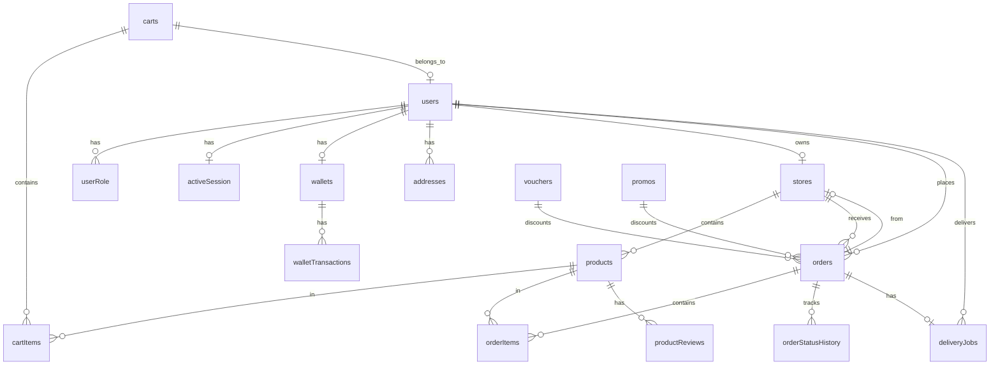

# Database Schema Reference

SEAPEDIA uses PostgreSQL with Drizzle ORM, one database per service. Each service keeps its schema in `services/<service>/src/db/schema/`: identity owns users, roles and sessions; catalog owns stores, products and reviews; commerce owns everything else, plus `inventory`, `product_refs` and `store_refs`. Relationships below that cross services are logical only: the columns hold ids but there is no foreign key. See [architecture/data-ownership.md](./architecture/data-ownership.md).

Since the split, `products.stock` in catalog is a read model of commerce's `inventory`, and `product_reviews` stores a `reviewer_name` snapshot.

## Entity Relationship Diagram

## Tables

### Auth & Users (`auth-schema.ts`)

#### `users`

| Column | Type | Constraints | Description |
|--------|------|-------------|-------------|
| `id` | UUID | PK | User ID |
| `username` | VARCHAR | UNIQUE, NOT NULL | Username |
| `email` | VARCHAR | UNIQUE, NOT NULL | Email address |
| `passwordHash` | VARCHAR | NOT NULL | Bcrypt password hash |
| `name` | VARCHAR | | Full name |
| `isOnboarded` | BOOLEAN | DEFAULT false | Onboarding complete |
| `avatarKey` | VARCHAR | | R2 object key for avatar |
| `createdAt` | TIMESTAMP | DEFAULT now() | Creation timestamp |
| `updatedAt` | TIMESTAMP | DEFAULT now() | Last update timestamp |

#### `userRole`

| Column | Type | Constraints | Description |
|--------|------|-------------|-------------|
| `id` | UUID | PK | Role ID |
| `userId` | UUID | FK → users, NOT NULL | User reference |
| `role` | VARCHAR | NOT NULL | 'admin', 'seller', 'buyer', 'driver' |
| `createdAt` | TIMESTAMP | DEFAULT now() | Creation timestamp |

#### `activeSession`

| Column | Type | Constraints | Description |
|--------|------|-------------|-------------|
| `id` | UUID | PK | Session ID |
| `userId` | UUID | FK → users, UNIQUE, NOT NULL | User reference |
| `activeRole` | VARCHAR | NOT NULL | Currently active role |
| `createdAt` | TIMESTAMP | DEFAULT now() | Creation timestamp |
| `updatedAt` | TIMESTAMP | DEFAULT now() | Last update timestamp |

### Stores (`store-schema.ts`)

#### `stores`

| Column | Type | Constraints | Description |
|--------|------|-------------|-------------|
| `id` | UUID | PK | Store ID |
| `sellerId` | UUID | FK → users, UNIQUE, NOT NULL | Owner reference |
| `name` | VARCHAR | UNIQUE, NOT NULL | Store name |
| `slug` | VARCHAR | UNIQUE, NOT NULL | URL-friendly slug |
| `description` | TEXT | | Store description |
| `logoKey` | VARCHAR | | R2 object key for logo |
| `rating` | DECIMAL(3,2) | DEFAULT '0.00' | Average rating |
| `reviewCount` | INTEGER | DEFAULT 0 | Number of reviews |
| `totalProducts` | INTEGER | DEFAULT 0 | Product count |
| `createdAt` | TIMESTAMP | DEFAULT now() | Creation timestamp |
| `updatedAt` | TIMESTAMP | DEFAULT now() | Last update timestamp |

### Products (`product-schema.ts`)

#### `products`

| Column | Type | Constraints | Description |
|--------|------|-------------|-------------|
| `id` | UUID | PK | Product ID |
| `storeId` | UUID | FK → stores, NOT NULL | Store reference |
| `name` | VARCHAR | NOT NULL | Product name |
| `slug` | VARCHAR | UNIQUE, NOT NULL | URL-friendly slug |
| `description` | TEXT | | Product description |
| `price` | INTEGER | NOT NULL | Price in IDR (integer) |
| `stock` | INTEGER | NOT NULL | Available stock |
| `imageKey` | VARCHAR | | R2 object key for image |
| `rating` | DECIMAL(3,2) | DEFAULT '0.00' | Average rating |
| `reviewCount` | INTEGER | DEFAULT 0 | Number of reviews |
| `soldCount` | INTEGER | DEFAULT 0 | Units sold |
| `createdAt` | TIMESTAMP | DEFAULT now() | Creation timestamp |
| `updatedAt` | TIMESTAMP | DEFAULT now() | Last update timestamp |

### Buyer Domain (`buyer-schema.ts`)

#### `wallets`

| Column | Type | Constraints | Description |
|--------|------|-------------|-------------|
| `id` | UUID | PK | Wallet ID |
| `userId` | UUID | FK → users, UNIQUE, NOT NULL | User reference |
| `balance` | INTEGER | NOT NULL, DEFAULT 0 | Balance in IDR |
| `createdAt` | TIMESTAMP | DEFAULT now() | Creation timestamp |
| `updatedAt` | TIMESTAMP | DEFAULT now() | Last update timestamp |

#### `walletTransactions`

| Column | Type | Constraints | Description |
|--------|------|-------------|-------------|
| `id` | UUID | PK | Transaction ID |
| `walletId` | UUID | FK → wallets, NOT NULL | Wallet reference |
| `amount` | INTEGER | NOT NULL | Transaction amount |
| `type` | VARCHAR | NOT NULL | 'topup', 'payment', 'refund' |
| `status` | VARCHAR | NOT NULL | 'success', 'pending', 'failed' |
| `reference` | VARCHAR | | Transaction reference |
| `createdAt` | TIMESTAMP | DEFAULT now() | Creation timestamp |

#### `addresses`

| Column | Type | Constraints | Description |
|--------|------|-------------|-------------|
| `id` | UUID | PK | Address ID |
| `userId` | UUID | FK → users, NOT NULL | User reference |
| `label` | VARCHAR | NOT NULL | 'Home', 'Office', etc. |
| `recipientName` | VARCHAR | NOT NULL | Recipient name |
| `phoneNumber` | VARCHAR | NOT NULL | Contact phone |
| `province` | VARCHAR | NOT NULL | Province name |
| `city` | VARCHAR | NOT NULL | City name |
| `district` | VARCHAR | NOT NULL | District name |
| `postalCode` | VARCHAR | NOT NULL | 5-digit postal code |
| `fullAddress` | TEXT | NOT NULL | Detailed address |
| `isDefault` | BOOLEAN | DEFAULT false | Default address flag |
| `createdAt` | TIMESTAMP | DEFAULT now() | Creation timestamp |
| `updatedAt` | TIMESTAMP | DEFAULT now() | Last update timestamp |

### Cart (`cart-schema.ts`)

#### `carts`

| Column | Type | Constraints | Description |
|--------|------|-------------|-------------|
| `id` | UUID | PK | Cart ID |
| `buyerId` | UUID | FK → users, UNIQUE, NOT NULL | Buyer reference |
| `storeId` | UUID | FK → stores | Current store (single-store) |
| `createdAt` | TIMESTAMP | DEFAULT now() | Creation timestamp |
| `updatedAt` | TIMESTAMP | DEFAULT now() | Last update timestamp |

#### `cartItems`

| Column | Type | Constraints | Description |
|--------|------|-------------|-------------|
| `id` | UUID | PK | Cart item ID |
| `cartId` | UUID | FK → carts, NOT NULL | Cart reference |
| `productId` | UUID | FK → products, NOT NULL | Product reference |
| `quantity` | INTEGER | NOT NULL | Quantity |
| `createdAt` | TIMESTAMP | DEFAULT now() | Creation timestamp |
| | | UNIQUE(cartId, productId) | One entry per product |

### Orders (`order-schema.ts`)

#### `orders`

| Column | Type | Constraints | Description |
|--------|------|-------------|-------------|
| `id` | UUID | PK | Order ID |
| `buyerId` | UUID | FK → users, NOT NULL | Buyer reference |
| `storeId` | UUID | FK → stores, NOT NULL | Store reference |
| `deliveryMethod` | VARCHAR | NOT NULL | 'instant', 'next_day', 'regular' |
| `subtotal` | INTEGER | NOT NULL | Sum of item prices |
| `discountAmount` | INTEGER | DEFAULT 0 | Applied discount |
| `discountCode` | VARCHAR | | Voucher/Promo code used |
| `discountType` | VARCHAR | | 'voucher' or 'promo' |
| `deliveryFee` | INTEGER | NOT NULL | Delivery fee |
| `ppn` | INTEGER | NOT NULL | 12% tax |
| `totalAmount` | INTEGER | NOT NULL | Final charged amount |
| `status` | VARCHAR | NOT NULL | Current order status |
| `addressSnapshot` | JSONB | NOT NULL | Delivery address at checkout |
| `createdAt` | TIMESTAMP | DEFAULT now() | Creation timestamp |
| `updatedAt` | TIMESTAMP | DEFAULT now() | Last update timestamp |

#### `orderItems`

| Column | Type | Constraints | Description |
|--------|------|-------------|-------------|
| `id` | UUID | PK | Order item ID |
| `orderId` | UUID | FK → orders, NOT NULL | Order reference |
| `productId` | UUID | FK → products (SET NULL) | Product reference |
| `productName` | VARCHAR | NOT NULL | Product name snapshot |
| `productPrice` | INTEGER | NOT NULL | Price snapshot |
| `quantity` | INTEGER | NOT NULL | Quantity |
| `createdAt` | TIMESTAMP | DEFAULT now() | Creation timestamp |

#### `orderStatusHistory`

| Column | Type | Constraints | Description |
|--------|------|-------------|-------------|
| `id` | UUID | PK | History ID |
| `orderId` | UUID | FK → orders, NOT NULL | Order reference |
| `status` | VARCHAR | NOT NULL | Status at this point |
| `note` | TEXT | | Description of the change |
| `createdAt` | TIMESTAMP | DEFAULT now() | Timestamp of change |

### Discounts (`discount-schema.ts`)

#### `vouchers`

| Column | Type | Constraints | Description |
|--------|------|-------------|-------------|
| `id` | UUID | PK | Voucher ID |
| `code` | VARCHAR | UNIQUE, NOT NULL | Voucher code |
| `discountAmount` | INTEGER | NOT NULL | Flat discount in IDR |
| `minOrderAmount` | INTEGER | NOT NULL | Minimum order subtotal |
| `expiresAt` | TIMESTAMP | NOT NULL | Expiry date |
| `remainingUsage` | INTEGER | NOT NULL | Times it can still be used |
| `createdAt` | TIMESTAMP | DEFAULT now() | Creation timestamp |
| `updatedAt` | TIMESTAMP | DEFAULT now() | Last update timestamp |

#### `promos`

| Column | Type | Constraints | Description |
|--------|------|-------------|-------------|
| `id` | UUID | PK | Promo ID |
| `code` | VARCHAR | UNIQUE, NOT NULL | Promo code |
| `discountPercent` | INTEGER | NOT NULL | 1-100% |
| `maxDiscountAmount` | INTEGER | | Cap on discount (nullable) |
| `minOrderAmount` | INTEGER | NOT NULL | Minimum order subtotal |
| `expiresAt` | TIMESTAMP | NOT NULL | Expiry date |
| `createdAt` | TIMESTAMP | DEFAULT now() | Creation timestamp |
| `updatedAt` | TIMESTAMP | DEFAULT now() | Last update timestamp |

### Delivery (`delivery-schema.ts`)

#### `deliveryJobs`

| Column | Type | Constraints | Description |
|--------|------|-------------|-------------|
| `id` | UUID | PK | Job ID |
| `orderId` | UUID | FK → orders, UNIQUE, NOT NULL | Order reference |
| `driverId` | UUID | FK → users | Driver reference (set when taken) |
| `status` | VARCHAR | NOT NULL | 'pending', 'taken', 'completed' |
| `deliveryFee` | INTEGER | NOT NULL | Fee earned by driver |
| `createdAt` | TIMESTAMP | DEFAULT now() | Creation timestamp |
| `updatedAt` | TIMESTAMP | DEFAULT now() | Last update timestamp |

### Reviews

#### `appReview` (`review-schema.ts`)

| Column | Type | Constraints | Description |
|--------|------|-------------|-------------|
| `id` | UUID | PK | Review ID |
| `reviewerName` | VARCHAR | NOT NULL | Reviewer name |
| `rating` | INTEGER | NOT NULL | 1-5 rating |
| `comment` | TEXT | | Review comment |
| `createdAt` | TIMESTAMP | DEFAULT now() | Creation timestamp |

#### `productReviews` (`product-review-schema.ts`)

| Column | Type | Constraints | Description |
|--------|------|-------------|-------------|
| `id` | UUID | PK | Review ID |
| `productId` | UUID | FK → products, NOT NULL | Product reference |
| `buyerId` | UUID | FK → users, NOT NULL | Buyer reference |
| `rating` | INTEGER | NOT NULL | 1-5 rating |
| `comment` | TEXT | | Review comment |
| `createdAt` | TIMESTAMP | DEFAULT now() | Creation timestamp |
| | | UNIQUE(productId, buyerId) | One review per buyer per product |

### System (`system-time-offset-schema.ts`)

#### `systemTimeOffset`

| Column | Type | Constraints | Description |
|--------|------|-------------|-------------|
| `id` | INTEGER | PK (always 1) | Singleton row |
| `offsetSeconds` | INTEGER | NOT NULL, DEFAULT 0 | Time offset in seconds |
| `updatedAt` | TIMESTAMP | DEFAULT now() | Last update timestamp |

## Schema Files

| File | Tables |
|------|--------|
| `auth-schema.ts` | users, userRole, activeSession |
| `store-schema.ts` | stores |
| `product-schema.ts` | products |
| `buyer-schema.ts` | wallets, walletTransactions, addresses |
| `cart-schema.ts` | carts, cartItems |
| `order-schema.ts` | orders, orderItems, orderStatusHistory |
| `discount-schema.ts` | vouchers, promos |
| `delivery-schema.ts` | deliveryJobs |
| `review-schema.ts` | appReview |
| `product-review-schema.ts` | productReviews |
| `system-time-offset-schema.ts` | systemTimeOffset |
| `index.ts` | Re-exports all tables |
