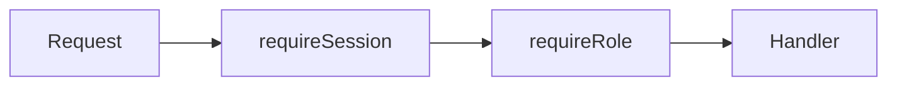

# Security Measures

SEAPEDIA implements security hardening across authentication, input handling, database access, and authorization. This document covers the measures implemented in Level 7.

## SQL Injection Prevention

### Approach

All database access uses **Drizzle ORM** with parameterized queries. Raw SQL is never used for user-facing operations.

### Implementation

- Drizzle's type-safe query builder automatically escapes user input
- All queries use parameterized statements
- No string interpolation in SQL queries

### Example

```typescript
// Safe — Drizzle parameterizes this
const result = await db
  .select()
  .from(users)
  .where(eq(users.email, userInput));

// Unsafe — NEVER done in this codebase
// const result = await db.execute(`SELECT * FROM users WHERE email = '${userInput}'`);
```

### Verification

Input SQL-like payloads into any form field. The input is treated as a literal string and does not affect database queries.

## XSS Prevention

### Approach

User-generated content is rendered safely using React's built-in JSX escaping.

### Implementation

- React automatically escapes content in JSX expressions
- HTML tags in user input are rendered as plain text
- No `dangerouslySetInnerHTML` is used for user content
- Application reviews, product reviews, and comments are all rendered as text

### Example

```tsx
// Safe — React escapes this
<p>{review.comment}</p>

// If comment is "<script>alert('XSS')</script>"
// It renders as literal text, not executable code
```

### Verification

Submit a review with the comment: `<script>alert('XSS')</script>`

The script tag should appear as plain text on the page, not trigger an alert.

## Input Validation

### Approach

Every HTTP boundary is validated using **Zod schemas**. Invalid input is rejected with structured error responses.

### Implementation

- Request body, query params, and path params are all validated
- Required fields are enforced server-side
- Type checks, range checks, and format checks are applied
- Structured 400 Bad Request responses with field-level errors

### Validated Fields

| Field | Validation |
|-------|------------|
| Email | Format validation |
| Phone | Format validation |
| Rating | Integer 1-5 |
| Quantity | Positive integer |
| Price | Non-negative integer |
| Stock | Non-negative integer |
| Discount values | Positive, within range |
| Username | Min length, unique |
| Password | Min 8 characters |

### Example Response

```json
{
  "error": "Validation failed",
  "details": [
    {
      "path": ["email"],
      "message": "Invalid email format"
    }
  ]
}
```

## Session & Token Behavior

### Token Configuration

| Property | Access token | Refresh token |
|----------|--------------|---------------|
| Format | RS256 JWT (identity's private key; Kong and services hold the public key) | 256-bit random, stored as SHA-256 |
| Expiry | 10 minutes | 7 days, rotated on every use |
| Storage | HttpOnly cookie `__access` | HttpOnly cookie `__refresh`, path `/api/auth` |
| Secure | Yes (in production) | Yes (in production) |
| SameSite | Lax | Lax |

### Session Lifecycle

1. **Creation**: each login opens a session for that device and issues both tokens.
2. **Validation**: Kong verifies the access token's signature and expiry; the owning service verifies it again and checks the session denylist.
3. **Refresh**: `POST /api/auth/refresh` rotates the refresh token. A refresh token used twice revokes the session (it leaked).
4. **Invalidation**: logout revokes the session and publishes `identity.session.revoked`; every service rejects that session's access tokens immediately.

See [architecture/security.md](./architecture/security.md) for the full model, including service-to-service tokens and RabbitMQ permissions.

## Role-Based Access Control (RBAC)

### Enforcement

Authorization is enforced **server-side** on every protected endpoint. The frontend UI is never trusted for access control.

### Middleware Chain



- `requireSession`: Verifies JWT, validates session, sets `userId` and `activeRole`
- `requireRole`: Checks if `activeRole` matches the endpoint's required role

### Role Isolation

| Action | Required Active Role |
|--------|---------------------|
| Create/update/delete products | Seller (own store only) |
| View wallet, checkout | Buyer (own wallet only) |
| Take/complete delivery jobs | Driver (available/own jobs) |
| Dashboard stats, time simulation | Admin |
| View orders | Buyer (own orders) or Seller (own store orders) |

### Resource Ownership

- Sellers can only manage their own store and products
- Buyers can only view their own orders and wallet
- Drivers can only take available jobs and complete their own taken jobs
- Admin has full access to all resources

### Multi-Role Safety

- User with multiple roles can only perform actions for the **active role**
- Backend verifies `activeRole` matches the required role
- Switching roles requires explicit API call (`POST /api/auth/select-role`)

## Additional Security Measures

### Password Security

- Passwords are hashed using **bcrypt** via Bun's native `Bun.password.hash()`
- Raw passwords are never stored
- Password comparison uses constant-time comparison

### CORS

- Backend only allows requests from configured `FRONTEND_URL`
- Credentials are allowed (`credentials: 'include'`)

### Error Handling

- Domain errors are mapped to appropriate HTTP status codes
- Internal errors return generic messages (no stack traces in production)
- Structured error responses with error type and message

## Security Test Checklist

### SQL Injection

- [ ] Input `' OR 1=1 --` into login form → treated as literal string
- [ ] Input `' UNION SELECT * FROM users --` into search → no data leak
- [ ] Input SQL keywords into review comment → stored and rendered as text

### XSS

- [ ] Input `<script>alert('XSS')</script>` into review comment → renders as text
- [ ] Input `` into review → renders as text
- [ ] Input `<svg onload=alert(1)>` into any text field → renders as text

### Input Validation

- [ ] Submit registration with invalid email → 400 Bad Request
- [ ] Submit product with negative price → 400 Bad Request
- [ ] Submit review with rating 6 → 400 Bad Request
- [ ] Submit checkout with quantity 0 → 400 Bad Request

### Session Security

- [ ] Logout → session deleted from database
- [ ] Use old JWT after logout → 401 Unauthorized
- [ ] Wait for JWT expiry → 401 Unauthorized
- [ ] Cookie is HttpOnly (not accessible via JavaScript)

### RBAC

- [ ] Access `/api/admin/summary` as buyer → 403 Forbidden
- [ ] Access `/api/seller/products` as buyer → 403 Forbidden
- [ ] Access `/api/driver/jobs` as seller → 403 Forbidden
- [ ] Access another seller's product → 403 Forbidden
- [ ] Access another buyer's order → 403 Forbidden

## Code References

| Component | File |
|-----------|------|
| Auth middleware | `packages/platform/src/internal-auth.ts` |
| JWT handling | `services/identity/src/lib/jwt.ts` |
| Zod validation | Throughout `services/*/src/modules/*/` |
| Error handling | `packages/platform/src/errors.ts`, `packages/platform/src/service.ts` |
| CORS, rate limits, JWT at the edge | `infra/kong/kong.yml.tmpl` |
