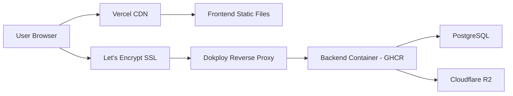

# SEAPEDIA Setup & Deployment

This document covers local development setup, environment configuration, and production deployment.

## Prerequisites

- [Bun](https://bun.sh) >= 1.2
- [PostgreSQL](https://www.postgresql.org/) >= 15
- [Docker](https://www.docker.com/) (optional, for containerized setup)

## Local Development

### 1. Clone the Repository

```bash
git clone https://github.com/your-username/seapedia.git
cd seapedia
```

### 2. Backend Setup

```bash
cd backend
cp .env.example .env    # Configure environment variables
bun install
bun run db:migrate      # Apply database migrations
bun run db:seed         # Seed demo accounts
bun run dev             # Start dev server on :3001
```

### 3. Frontend Setup

```bash
cd frontend
cp .env.example .env    # Configure environment variables
bun install
bun run dev             # Start dev server on :5173
```

### 4. Docker (Alternative)

```bash
docker compose up --build
```

This starts PostgreSQL, backend, and frontend in containers.

## Environment Variables

### Backend (`backend/.env`)

| Variable | Required | Description |
|----------|----------|-------------|
| `DATABASE_URL` | Yes | PostgreSQL connection string |
| `JWT_SECRET` | Yes | Secret key for signing JWTs (min 8 chars) |
| `PORT` | No | Server port (default: 3001) |
| `NODE_ENV` | No | `development`, `production`, or `test` |
| `FRONTEND_URL` | No | Allowed CORS origin (default: `http://localhost:5173`) |
| `R2_ACCOUNT_ID` | Yes | Cloudflare R2 account ID |
| `R2_ACCESS_KEY_ID` | Yes | Cloudflare R2 access key ID |
| `R2_SECRET_ACCESS_KEY` | Yes | Cloudflare R2 secret access key |
| `R2_BUCKET_NAME` | Yes | R2 bucket name (e.g., `seapedia`) |
| `R2_PUBLIC_DOMAIN` | Yes | Public CDN domain (e.g., `cdn.seapedia.com`) |

### Frontend (`frontend/.env`)

| Variable | Required | Default | Description |
|----------|----------|---------|-------------|
| `VITE_API_URL` | Yes | `http://localhost:3001` | Backend API base URL |
| `VITE_APP_URL` | No | `http://localhost:5173` | Public frontend URL |

## Production Deployment

### Live URLs

| Component | URL | Hosting |
|-----------|-----|---------|
| Frontend | `seapedia.sayyidrafee.com` | Vercel (Hobby plan, static build) |
| Backend API | `api-seapedia.sayyidrafee.com` | Self-hosted VPS (Dokploy) |
| Database | — | PostgreSQL on same VPS |

### Architecture



### Backend Deployment (Dokploy)

1. Backend image is built and pushed to GitHub Container Registry (GHCR) via GitHub Actions
2. Dokploy watches for new images via webhook
3. Dokploy pulls the latest image and deploys it
4. SSL is managed by Let's Encrypt through Dokploy
5. Environment variables are configured in Dokploy dashboard

### Frontend Deployment (Vercel)

1. Frontend is built as a static SPA (`bun run build`)
2. Vercel deploys the `dist/` output
3. The `VITE_API_URL` environment variable points to the production backend

### Database

PostgreSQL runs on the same VPS as the backend container. The `DATABASE_URL` in the Dokploy configuration points to `localhost:5432` (or the configured port) with the appropriate database credentials.

## Useful Commands

### Backend

| Command | Description |
|---------|-------------|
| `bun run dev` | Start dev server with hot reload |
| `bun run check` | TypeScript type check |
| `bun run lint` | Run oxlint |
| `bun run format` | Run oxfmt |
| `bun run fl` | Format then lint |
| `bun test` | Run tests |
| `bun run db:generate` | Create Drizzle migration |
| `bun run db:migrate` | Apply migration |
| `bun run db:seed` | Seed demo accounts |
| `bun run db:studio` | Open Drizzle Studio |

### Frontend

| Command | Description |
|---------|-------------|
| `bun run dev` | Start Vite dev server |
| `bun run build` | Production build |
| `bun run preview` | Preview production build |
| `bun run check` | TypeScript type check |
| `bun run lint` | Run oxlint |
| `bun run format` | Run oxfmt |
| `bun run test` | Run Vitest tests |
| `bun run openapi:generate` | Regenerate API SDK |

## API Documentation

Interactive API documentation is available via Scalar:

| Environment | URL |
|-------------|-----|
| Local | [http://localhost:3001/docs](http://localhost:3001/docs) |
| Production | [https://api-seapedia.sayyidrafee.com/docs](https://api-seapedia.sayyidrafee.com/docs) |

The OpenAPI JSON spec is served at `/openapi.json`.

## Troubleshooting

### Database Connection Issues

```bash
# Check PostgreSQL is running
pg_isready -h localhost -p 5432

# Reset database
cd backend
bun run db:migrate
bun run db:seed
```

### CORS Issues

Ensure `FRONTEND_URL` in the backend `.env` matches the frontend URL exactly (including protocol and port).

### R2 Upload Failures

Verify all `R2_*` environment variables are set correctly. The backend uses presigned URLs — the frontend uploads directly to R2, so R2 must be accessible from the client's browser.
