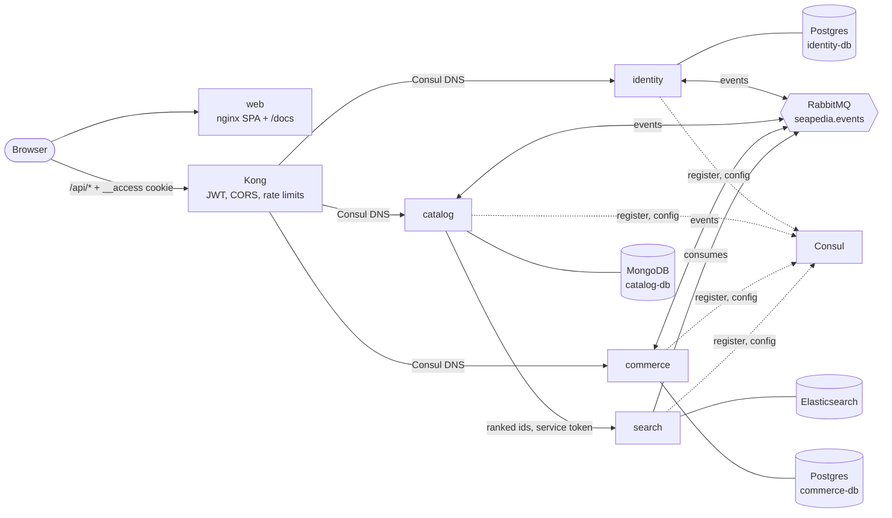

# Architecture overview

Seapedia is a set of microservices behind Kong. Four services own their data in a database chosen
for their workload; they integrate through events on RabbitMQ (choreography, no orchestrator);
Consul holds configuration and the service registry.

## Service types

| Type | Services | Role |
| --- | --- | --- |
| Edge / API gateway | Kong | single public entry: JWT check, CORS, rate limits, routing |
| Domain services | identity, catalog, commerce | own their data and rules; publish and consume events |
| Query / read model (CQRS read side) | search | projection of catalog events; answers search queries |
| Backing services | Postgres ×2, MongoDB, Elasticsearch, RabbitMQ, Consul | used by services, no business logic |
| Jobs | seed, reindex | one-off operational tasks |
| Frontend | web | static SPA; talks only to Kong |

## Services

| Service | Owns | Store | Public routes (via Kong) |
| --- | --- | --- | --- |
| identity | accounts, roles, sessions, tokens, service credentials | Postgres | `/api/auth`, `/api/users`, `/api/private`, `/.well-known/jwks.json` |
| catalog | stores, products, reviews | MongoDB (replica set) | `/api/products`, `/api/seller/products`, `/api/stores`, `/api/reviews` |
| commerce | wallet, cart, checkout, orders, discounts, delivery, admin, stock | Postgres | `/api/buyers`, `/api/orders`, `/api/seller/orders`, `/api/seller/inventory`, `/api/discounts`, `/api/driver`, `/api/admin`, `/api/locations` |
| search | product search index | Elasticsearch | none (internal) |

Each data store is its own server (container); no service can reach another's.

## Read next

- [Data ownership](./data-ownership.md): what each service stores, replicas, consistency.
- [Communication](./communication.md): events, the only synchronous calls, failure behaviour.
- [Security](./security.md): authentication and authorization at every layer.
- [Platform](./platform.md): Consul configuration and service discovery.
- [Decisions](./decisions/): why it is built this way.
- [Deployment](../DEPLOYMENT.md): one Dokploy application per service.

## Repository layout

One repository (a bun workspace) holds every service. Services share no business code; they share
`packages/platform`, which holds technical building blocks only (errors, OpenAPI helpers, storage,
JWT verification, event bus, Consul clients). Each service has its own Dockerfile, image, CI job,
and deployment; CI rebuilds a service when its directory, the platform package, or the lockfile
changes.
