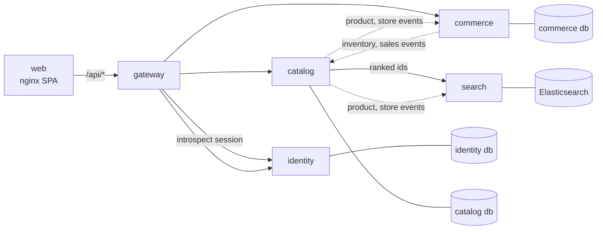

# Architecture overview

Seapedia is five services behind one gateway, plus a static web app. Each service has its own
image, deployment, and data store, and talks to the others only over HTTP: synchronous internal
calls for reads, and a transactional outbox for changes.

Solid arrows are request/response calls. Dotted arrows are outbox events the consumer pulls.

## Services

| Service | Owns | Store | Public routes |
| --- | --- | --- | --- |
| gateway | routing, session resolution, public API contract | none | all `/api/*`, `/docs`, `/openapi.json` |
| identity | users, roles, sessions | Postgres `identity` | `/api/auth`, `/api/users`, `/api/private` |
| catalog | stores, products, reviews | Postgres `catalog` | `/api/products`, `/api/seller/products`, `/api/stores`, `/api/reviews` |
| commerce | wallet, cart, orders, discounts, delivery, admin, stock | Postgres `commerce` | `/api/buyers`, `/api/orders`, `/api/seller/orders`, `/api/seller/inventory`, `/api/discounts`, `/api/driver`, `/api/admin`, `/api/locations` |
| search | product search index | Elasticsearch | none (internal) |

The three Postgres databases run on one Postgres server, each with its own login role that cannot
open the others (`infra/postgres/init`). Moving one to its own server is a connection-string change.

## Where to read next

- [Data ownership](./data-ownership.md): tables per service, replicas, and read models.
- [Communication](./communication.md): gateway, internal auth, internal calls, the outbox, and
  what happens when a service is down.
- [Decisions](./decisions/): why the system is split this way.
- [Deployment](../DEPLOYMENT.md): one Dokploy application per service.

## Repository layout

One repository holds all services (a bun workspace). Services share no business code: each one
imports only its own modules and `packages/platform`, which holds technical code (errors, OpenAPI
helpers, R2 storage, internal auth and HTTP client, outbox). CI builds and deploys each service on
its own, triggered by changes to that service's directory.
